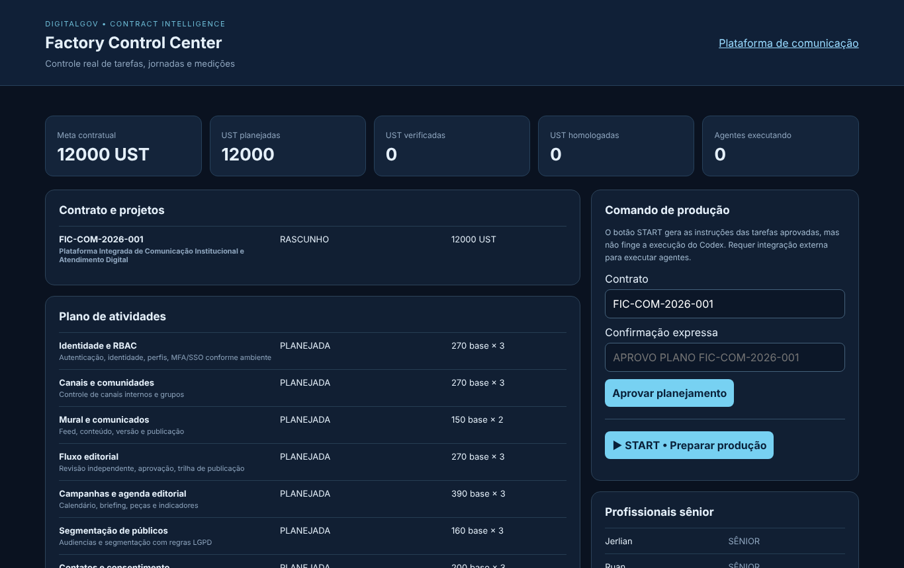
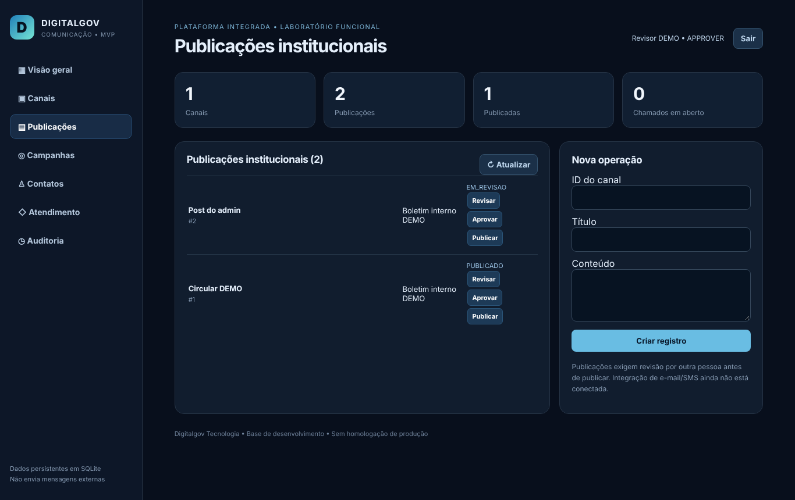

# Diagnóstico de instalação e execução — Pacote DIGITALGOV de Comunicação

Contrato **FIC-COM-2026-001** · Plataforma Integrada de Comunicação Institucional e Atendimento Digital · 06/11/2026

> **Contrato FICTÍCIO.** A minuta não está assinada e não há órgão contratante real (minuta, cl. 1 e 20). Este documento relata somente o que foi executado e medido nesta data. Nada aqui é aceite do contratante.

## 1. Resumo

| Item | Resultado |
|---|---|
| Integridade do pacote | 52 de 52 arquivos conferem com o manifesto SHA-256 |
| Testes automatizados do pacote | Fábrica 2/2 · Comunicação 1/1 — todos passaram |
| Serviços locais | Fábrica (porta 8777) e Comunicação (porta 8765) subiram e responderam |
| Teste de ponta a ponta pela API | 30 de 30 verificações passaram |
| Telas no navegador | Comunicação sem erros; painel da fábrica abria **vazio** |
| Defeito corrigido | Painel da fábrica: erro de JavaScript corrigido; testes 4/4 passaram |
| Novos achados | 13 falhas ou lacunas de segurança e validação (seção 6) |
| 18 módulos do TR | 0 completos · 8 parciais · 10 não implementados |
| Medição | 12.000 UST **planejadas** · 0 entregues · 0 verificadas · 0 aceitas |
| Horas humanas comprovadas | 0 h (nenhum registro de jornada recebido) |
| Situação | **Aguardando decisão e aprovação** do responsável (seção 10) |

## 2. O que foi feito hoje

- Leitura integral dos 12 documentos Word, da planilha de 12.000 UST, do prompt mestre e do código.
- Conferência do manifesto SHA-256 e cópia do pacote para `contratos/FIC-COM-2026-001/`.
- Instalação das dependências em ambiente isolado (Python 3.13, FastAPI 0.162, Uvicorn 0.54, Pydantic 2.14, python-docx 1.2).
- Execução dos testes do pacote, subida dos dois serviços e teste de ponta a ponta com usuários DEMO.
- Captura das telas com Playwright, registro dos erros de JavaScript e correção do painel da fábrica.
- Execução do gerador de relatório do próprio pacote (relatório Word anexo nas evidências).
- Preenchimento, no formulário do contrato, apenas dos campos que os documentos informam. A autorização de execução continua `false`.

**O que não foi feito, de propósito:** aprovar o plano, acionar o START, lançar horas, medir UST ou desenvolver módulos novos. As regras do pacote e da fábrica exigem aprovação expressa e OS autorizada antes disso.

## 3. Arquivos encontrados (Bloco 1)

| Grupo | Conteúdo | Quantidade |
|---|---|---|
| DOCUMENTOS | Contrato fictício, TR (18 módulos), OS proposta, protocolo de medição, equipe, fiscalização, manual, modelo de relatório, prompt, comando, planejamento de 6 meses, relatório de status | 12 .docx |
| PDFS_VISUALIZACAO | Contrato, TR, modelo de relatório, prompt mestre | 4 .pdf |
| PLANILHAS | Planejamento e medição: 6 abas (UST, cronograma, equipe, HST, painel, instruções) | 1 .xlsx |
| FABRICA | Factory Control Center: FastAPI + SQLite, 100 posições lógicas de agentes | 14 arquivos |
| PLATAFORMA_COMUNICACAO | MVP: login, canais, publicações, campanhas, contatos, chamados, auditoria | 13 arquivos |
| ENTREGAS_CODIGO_SEPARADAS | Os dois códigos acima em ZIP (hash conferido; não versionados por serem cópia) | 2 .zip |
| COMANDOS e raiz | Prompt mestre, comando inicial, LEIA_PRIMEIRO, STATUS, manifesto, script de início | 7 arquivos |

A planilha está coerente: **4.410 UST base × fatores 1, 2 ou 3 = 12.000 UST ajustadas**, distribuídas em 6 meses (1.000 / 1.600 / 2.000 / 2.600 / 2.600 / 2.200). Todas as colunas de executado, verificado e homologado estão em zero.

## 4. Funcionalidades efetivamente testadas (Bloco 2)

### 4.1 Testes automatizados

| Conjunto | Comando | Resultado |
|---|---|---|
| Fábrica (original) | `python -m pytest tests` | 2 passaram, 0 falharam |
| Comunicação | `python -m pytest tests` | 1 passou, 0 falharam |
| Fábrica (após correção) | `python -m pytest tests` | 4 passaram, 0 falharam (2 testes novos do painel) |

Execução em 06/11/2026, 13h19 (Brasília). Relatórios JUnit em `laboratorio/resultados/`.

### 4.2 Teste de ponta a ponta (serviços no ar, 30 verificações)

| Área | O que foi provado | Resultado |
|---|---|---|
| Acesso | Senha errada, sem token e token adulterado são recusados (401) | 3/3 |
| Perfis | Leitor não cria canal, não vê contatos, não exporta CSV (403) | 3/3 |
| Fluxo editorial | Rascunho → revisão → aprovação por outra pessoa → publicação | 5/5 |
| Segregação | Autor não aprova o próprio texto, nem sendo ADMIN (409) | 1/1 |
| Envio externo | Publicação informa `NAO_EXECUTADA`; nada é simulado | 1/1 |
| Cadastros | Canal, campanha, contato com consentimento, chamado | 5/5 |
| Validação | Prioridade inválida e senha curta são recusadas (422) | 2/2 |
| Atendimento | Chamado resolvido; painel mostra 0 em aberto | 2/2 |
| Auditoria e CSV | Trilha registrada (11 eventos); exportação para revisor | 2/2 |
| Fábrica | Aprovação exige a frase exata; START bloqueado sem plano; 18 tarefas; soma 12.000; 10 posições de equipe | 5/5 |
| Lacuna confirmada | Painel da fábrica responde **sem login** | 1/1 |

Os usuários usados (admin, editor, revisor, leitor) são DEMO, criados num banco temporário. Nenhum dado real foi usado.

### 4.3 Defeito encontrado e corrigido

| Item | Antes | Depois |
|---|---|---|
| Painel da fábrica (`FABRICA/static/index.html`) | Uma chave `}` a mais impedia o JavaScript de rodar; a tela abria sem números, tarefas nem equipe | Corrigido; o painel mostra 12.000 planejadas, 0 verificadas, 0 homologadas, 18 tarefas e a equipe |
| Escape de texto do painel | O apóstrofo virava o texto "undefined" | Corrigido |
| Prova | Erro do navegador: `Unexpected token '}'` | 0 erros no navegador; 2 testes novos passam |

## 5. Matriz de aderência aos 18 módulos

Legenda: **PARCIAL** = existe código funcionando e testado, mas não cobre o critério de aceite inteiro. **NÃO** = não há código.

| Módulo | UST plan. | Situação | O que existe | O que falta |
|---|---|---|---|---|
| M01 Identidade e RBAC | 810 | PARCIAL | Login PBKDF2, token assinado de 8 h, 4 perfis | MFA/SSO, revogação de sessão, limite de tentativas |
| M02 Canais | 810 | PARCIAL | Criar e listar com permissão | Editar, excluir, visibilidade, comunidades |
| M03 Mural e comunicados | 300 | PARCIAL | Publicações com estados | Versão, destaque; **leitor vê rascunhos** (critério não atendido) |
| M04 Aprovação editorial | 810 | PARCIAL | Revisão por outra pessoa, estados testados | Devolver para correção, motivo, versionamento |
| M05 Campanhas e calendário | 1.170 | PARCIAL | Criar e listar | Briefing, metas, peças, calendário, indicadores |
| M06 Audiências | 480 | NÃO | — | Tudo |
| M07 Contatos e consentimento | 600 | PARCIAL | Cadastro, consentimento sim/não, leitura restrita | Finalidade, base legal, preferências, validação de e-mail |
| M08 Atendimento | 1.140 | PARCIAL | Chamados, prioridade, 3 estados, CSV | Protocolo, filas, atribuição, SLA |
| M09 Chat | 400 | NÃO | — | Tudo |
| M10 Envio multicanal | 400 | NÃO | Tabela de envios criada, sem uso | Provedores, opt-out, filas, comprovantes |
| M11 Portal do cidadão | 600 | NÃO | — | Tudo |
| M12 Acervo e documentos | 480 | NÃO | — | Tudo |
| M13 Eventos e agenda | 660 | NÃO | — | Tudo |
| M14 Pesquisas | 540 | NÃO | — | Tudo |
| M15 BI e relatórios | 480 | NÃO | 6 contadores na visão geral | Painéis, filtros, exportações |
| M16 Integrações e APIs | 600 | NÃO | API interna sem versão | Versionamento, webhooks, SSO, conectores |
| M17 LGPD e auditoria | 400 | PARCIAL | Registro de criações e mudanças | Imutabilidade, retenção, leitura e falhas de login, pedidos de titulares |
| M18 DevOps e transferência | 1.320 | NÃO | README e script de início | CI, migrações, contêiner, backup, monitoramento |
| **Total** | **12.000** | | | |

Os 8 módulos parciais somam 6.040 UST planejadas, e os 10 não implementados somam 5.960. **Nenhuma dessas quantidades pode ser medida agora:** o código veio pronto no pacote (não foi produzido sob OS deste contrato), o catálogo não está homologado e não há OS autorizada.

## 6. Falhas, lacunas e riscos (Bloco 3)

| # | Achado | Gravidade | Prova | Correção proposta |
|---|---|---|---|---|
| 1 | Painel da fábrica abria vazio | Alta | Erro no navegador | **Corrigido hoje** |
| 2 | Painel da fábrica sem login: qualquer pessoa com acesso à porta aprova plano e aciona START | Alta se exposto | API respondeu 200 sem credencial | Login e perfis antes de qualquer uso fora do computador local |
| 3 | Leitor vê publicações em rascunho e revisão | Média | Código de `/api/posts` | Filtrar por estado conforme o perfil |
| 4 | Chamado com contato inexistente derruba a requisição (erro 500) | Média | Teste extra: HTTP 500 | Validar o contato e responder 404 |
| 5 | Exportação CSV aceita fórmulas (ex.: `=HYPERLINK`) | Média | Chamado criado com fórmula | Neutralizar células que começam com `= + - @` |
| 6 | Login sem limite de tentativas | Média | 12 erros seguidos sem bloqueio | Limite por usuário e IP, com registro |
| 7 | Token sem revogação; sair só limpa o navegador | Média | Código de `security.py` | Lista de sessões e revogação no servidor |
| 8 | Sem migrações versionadas (o TR exige) | Média | `CREATE TABLE IF NOT EXISTS` | Alembic com PostgreSQL |
| 9 | Sem cabeçalhos de segurança (CSP, X-Frame-Options) | Média | Resposta da página inicial | Incluir cabeçalhos no servidor |
| 10 | Campanha aceita canal inexistente | Baixa | Teste extra: HTTP 201 | Chave estrangeira e validação |
| 11 | E-mail do contato não é validado | Baixa | "isto-nao-e-email" aceito | Validação de e-mail |
| 12 | Leitor vê a descrição dos chamados (pode haver dado pessoal) | Baixa (LGPD) | Teste extra: HTTP 200 | Restringir ou mascarar |
| 13 | Dependências sem versão fixa; aviso de biblioteca obsoleta nos testes | Baixa | Saída do pytest | Fixar versões e trocar o cliente de teste |

**Riscos de contrato:** os 100 agentes são posições lógicas (0 em execução; não há conector Codex/Valide); envio de e-mail, SMS e push depende de provedor contratado; o banco SQLite serve para laboratório, não para produção.

## 7. Fábrica de controle: o que ela faz hoje

| Recurso | Situação |
|---|---|
| Contrato, projeto, OS e 18 tarefas planejadas | Funciona (cadastro de exemplo `seed-fiction`) |
| Aprovação do plano | Exige a frase exata `APROVO PLANO FIC-COM-2026-001`. **Não foi usada.** |
| START | Gera instruções em texto por tarefa; não executa agentes |
| Evidência com SHA-256, verificação e aceite documental | Funciona, com recusa se o arquivo mudar |
| Horas humanas | Exige fuso, evidência e recusa períodos sobrepostos |
| Relatório Word próprio | Gerado hoje; mostra 0 verificadas e 0 horas |
| Agentes em execução | 0 (o pacote declara isso corretamente) |

## 8. Medição: situação real

| Estado | UST |
|---|---|
| Meta (minuta) | 12.000 |
| Planejada (planilha) | 12.000 |
| Entregue sob OS | 0 |
| Tecnicamente verificada | 0 |
| Aceita pelo contratante | 0 |
| Glosada | 0 |
| Faturável | 0 |

Fórmula prevista: UST base elegível × fator 1, 2 ou 3 da OS (minuta, cl. 12). Valor da UST: a definir (cl. 17). O trabalho de hoje (diagnóstico e correção) é trabalho interno da fábrica e não gera UST.

## 9. Equipe

| Profissional | Senioridade informada | Função | Horas comprovadas |
|---|---|---|---|
| Jerlian | Sênior | A definir | 0 h |
| Ruan | Sênior | A definir | 0 h |
| Arthur Miguel | Sênior | A definir | 0 h |
| Warley | Sênior | A definir | 0 h |
| Werverton | Sênior | A definir | 0 h |
| João Miguel | Sênior | A definir | 0 h |
| Warley C. | Sênior | A confirmar identificação | 0 h |
| Profissionais 08, 09 e 10 | — | Vagas não indicadas | 0 h |

Nenhum CPF foi recebido nem registrado. A jornada de 9h às 18h é só previsão, não comprova trabalho.

## 10. Perguntas indispensáveis e decisão (Bloco 4)

1. **Natureza:** o contrato continua fictício (treino da fábrica) ou existe órgão, edital ou contrato real? Se real, envie os documentos.
2. **Autorização:** quem autoriza a OS (nome, cargo, data e documento)? Sem isso nada é executado.
3. **Catálogo:** aprovar o CATÁLOGO-PROPOSTO-V1 (fatores 1, 2 e 3) ou enviar o oficial?
4. **Preço:** valor da UST e limite de orçamento (cl. 17).
5. **Equipe:** função de cada um dos 7; nomes dos 3 que faltam; "Warley" e "Warley C." são pessoas diferentes?
6. **Tecnologia:** manter SQLite ou migrar para o padrão da fábrica (FastAPI + PostgreSQL + React, com Alembic)? **Recomendação: migrar.**
7. **Prioridade do mês 1:** recomendo M01 (identidade), M17 (auditoria), M18 (CI e migrações) e as correções 2 a 13.
8. **Integrações:** provedores de e-mail, SMS e push; login gov.br ou outro SSO; onde hospedar.
9. **Repositórios:** pela regra da fábrica, um repositório por sistema. Criar `digitalgov-comunicacao` e `digitalgov-fabrica-controle`?
10. **Correções já:** posso corrigir agora os achados 2 a 13, como correção técnica, sem medir UST?

**Decisão pendente.** Para iniciar a produção, o responsável precisa responder às perguntas 1 a 4 e escrever, na conversa, a aprovação expressa do plano. Até lá a fábrica fica em diagnóstico.

## 11. Onde está cada coisa

| Item | Caminho |
|---|---|
| Documentos originais do pacote | `contratos/FIC-COM-2026-001/documentos/pacote/` |
| Código das duas aplicações (com a correção) | `contratos/FIC-COM-2026-001/laboratorio/` |
| Resultados: JUnit, testes de API, logs, telas | `contratos/FIC-COM-2026-001/laboratorio/resultados/` |
| Scripts para repetir os testes | `contratos/FIC-COM-2026-001/laboratorio/resultados/scripts/` |
| Formulário do contrato | `contratos/FIC-COM-2026-001/contrato.yaml` |
