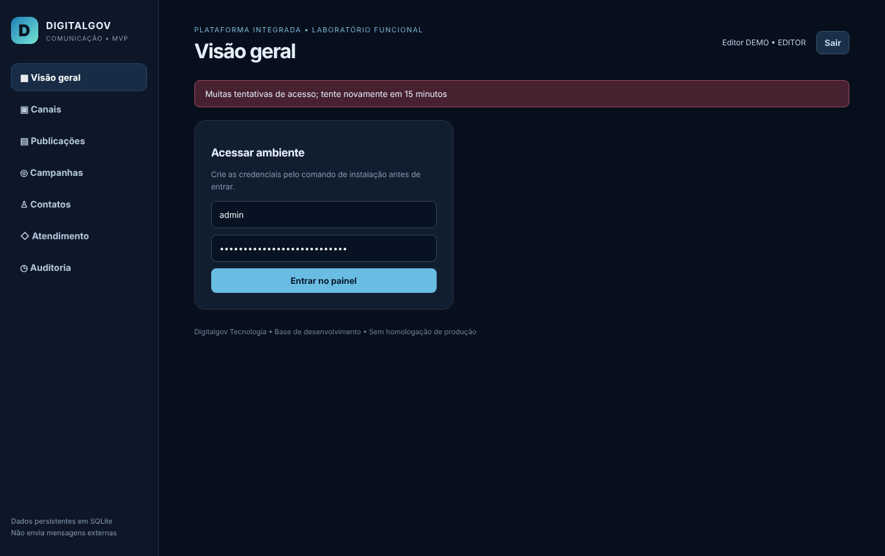
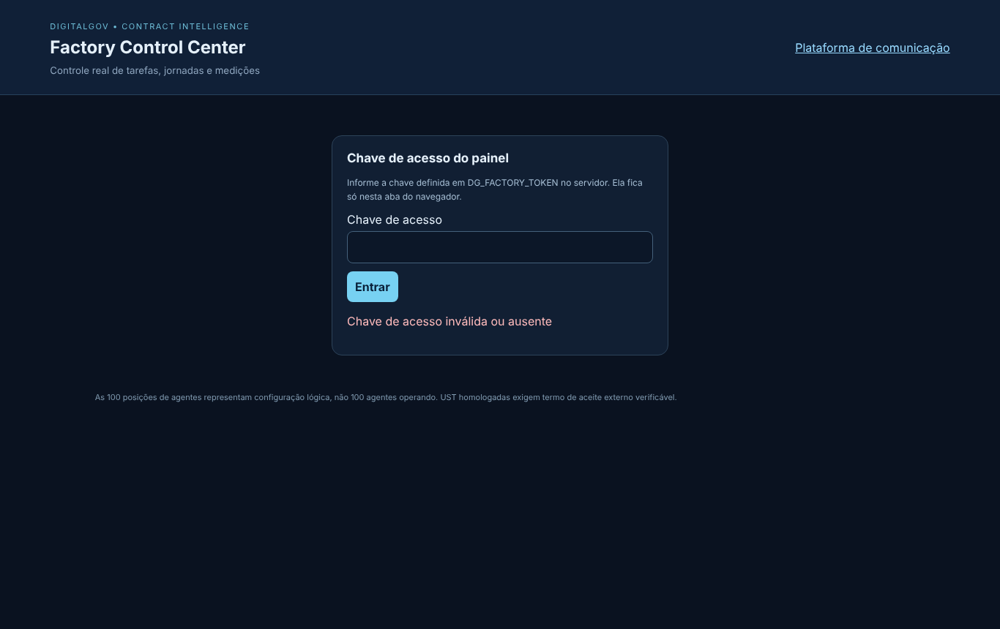

# Relatório de execução e medição — OS-FIC-002

Contrato **FIC-COM-2026-001** · Plataforma Integrada de Comunicação Institucional e Atendimento Digital · 06/11/2026

> O órgão contratante existe, mas ainda não enviou contrato nem OS assinada. Por isso a quantidade abaixo está **COMPROVADA** (executada, testada e auditada) e **não ACEITA**. Valor só é devido depois do termo de aceite do órgão.

## 1. Resumo

| Item | Resultado |
|---|---|
| Achados do diagnóstico | **13 de 13 corrigidos** (o nº 1 no diagnóstico, os outros 12 nesta OS), mais 3 defeitos novos encontrados nos testes |
| Módulos da OS | 4 módulos, todos com auditoria técnica **APROVADA** |
| Testes | 90 execuções pela fábrica, **0 falhas** (26 testes da comunicação, 12 do painel e a ida e volta das migrações, rodados por módulo) |
| Telas | 8 capturas reais no navegador, 0 erros de JavaScript |
| **UST comprovadas** | **202,5 UST** |
| **Valor comprovado** | **R$ 6.075,00** (202,5 × R$ 30,00) |
| UST aceitas pelo órgão | 0 |
| Pago | R$ 0,00 |
| Saldo do contrato | 11.797,5 UST de 12.000 |
| Horas humanas comprovadas | 0 h (nenhum programador participou ainda) |

## 2. Suas decisões, registradas no contrato

| Pergunta | Sua resposta | Onde ficou registrado |
|---|---|---|
| O órgão é real? | Existe | `contrato.yaml` — nome e documentos pendentes |
| Quem autoriza a OS? | Você | `contrato.yaml` e `os/OS-FIC-002.yaml` (autorização na conversa de 06/11/2026) |
| Catálogo e valor da UST | Aprovado, R$ 30,00 | `TABELA_UST.csv` (18 módulos) e `contrato.yaml` |
| Função da equipe | Programadores | `PROFISSIONAIS.csv` (P01 a P07) |
| Corrigir os achados? | Sim, e medir | OS-FIC-002 · decisão D-0004 · tarefa T-0030 |

## 3. O que foi corrigido

| Nº | Achado | Módulo da OS | Prova |
|---|---|---|---|
| 1 | Painel da fábrica abria vazio | MOD-004 | Teste do script do painel; tela sem erro |
| 2 | Painel da fábrica sem login | MOD-004 | Sem chave → 401; sem chave configurada → API fechada (503) |
| 3 | Leitor via rascunhos | MOD-002 | Leitor vê só a publicação PUBLICADA (teste e tela) |
| 4 | Contato inexistente gerava erro 500 | MOD-002 | Agora responde 404 |
| 5 | CSV aceitava fórmulas | MOD-002 | Células perigosas saem com apóstrofo |
| 6 | Login sem limite de tentativas | MOD-001 | 5 erros em 15 min → bloqueio (429), registrado na auditoria |
| 7 | Sair não encerrava a sessão no servidor | MOD-001 | Token usado depois de Sair → 401 |
| 8 | Sem migrações versionadas | MOD-003 | Migrações 0001–0003 com reversão, testadas ida e volta |
| 9 | Sem cabeçalhos de segurança | MOD-003 | CSP, X-Frame-Options, nosniff, Referrer-Policy |
| 10 | Campanha aceitava canal inexistente | MOD-002 | 404 e chave estrangeira no banco |
| 11 | E-mail sem validação | MOD-002 | E-mail inválido recusado com mensagem na tela |
| 12 | Leitor via descrição dos chamados | MOD-002 | Leitor recebe só assunto, prioridade e estado |
| 13 | Dependências sem versão fixa | MOD-003 | `requirements.txt` com versões exatas |

**Defeitos novos encontrados e corrigidos:** (a) o bloqueio de login sumia da auditoria (o erro desfazia o registro); (b) a tela mostrava "[object Object]" em vez da mensagem de validação; (c) na própria fábrica, o relatório lia linhas de exemplo do planejamento e a medição por tabela não calculava o valor em R$.

## 4. Testes executados pela fábrica

| Módulo | O que testa | Execuções | Falhas | Auditoria |
|---|---|---|---|---|
| MOD-001 Controle de sessão | 9 testes próprios + regressão da comunicação | 35 | 0 | APROVADO |
| MOD-002 Validação e privacidade | 8 testes próprios + regressão | 34 | 0 | APROVADO |
| MOD-003 Base técnica | 8 testes + ida e volta das migrações | 9 | 0 | APROVADO |
| MOD-004 Painel da fábrica | 12 testes | 12 | 0 | APROVADO |

Os testes foram escritos antes do código e vistos falhando primeiro. Logs e JUnit em `evidencias/OS-FIC-002/<módulo>/LOGS_TESTES/`.

## 5. Medição

| Módulo | Item do catálogo | UST comprovadas | Valor |
|---|---|---|---|
| MOD-001 Controle de sessão | CAT-M01-SESSAO | 202,5 | R$ 6.075,00 |
| MOD-002 Validação e privacidade | Correção sem item no catálogo | 0 | R$ 0,00 |
| MOD-003 Base técnica | Correção sem item no catálogo | 0 | R$ 0,00 |
| MOD-004 Painel da fábrica | Ferramenta interna (não é entregável) | 0 | R$ 0,00 |
| **Total** | | **202,5** | **R$ 6.075,00** |

**Memória de cálculo do MOD-001:** módulo M01 do catálogo = 270 UST base × fator 3 = 810 UST. O TR lista 4 itens no escopo do M01 (RBAC por perfil, controle de sessão, MFA/SSO, segregação editorial). Controle de sessão = 810 ÷ 4 = **202,5 UST** × R$ 30,00 = **R$ 6.075,00**.

**Por que os outros valem 0:**

- MOD-002 e MOD-003 corrigem defeitos do código que já veio no pacote. O catálogo aprovado não tem item de manutenção corretiva, e medir isso como módulo novo seria contagem duplicada.
- MOD-004 é o painel interno da fábrica, não faz parte do objeto do contrato (minuta, cl. 2).

**Regra de medição parcial:** dividir cada módulo pelos itens de escopo do TR é uma **proposta da fábrica**. O contrato do órgão é que define a regra. Se o órgão só medir módulo inteiro, o MOD-001 passa a valer 0 até o M01 ficar completo.

| Estado | UST | Valor |
|---|---|---|
| Comprovado (executado, testado, auditado) | 202,5 | R$ 6.075,00 |
| Aceito pelo órgão | 0 | R$ 0,00 |
| Pago | 0 | R$ 0,00 |

## 6. O que falta para esse valor ser pago

1. **Documentos do órgão:** nome do órgão, contrato assinado e OS emitida pelo órgão. Sem eles, a autorização é só interna.
2. **Confirmar a regra de medição parcial** (seção 5), ou enviar a regra do contrato real.
3. **Revisão humana:** um programador (P01 a P07) precisa revisar cada módulo e registrar a revisão. Até agora nenhum participou, e o relatório mostra isso.
4. **Termo de aceite** do fiscal do órgão sobre as 202,5 UST.

## 7. Como medir mais com trabalho real

| Opção | UST possíveis | Observação |
|---|---|---|
| M01: MFA/SSO | 202,5 | Depende do provedor de login (gov.br ou outro) |
| M18 DevOps (CI, backup, restauração etc.) | 1.320 no módulo (7 itens, cerca de 188,6 cada) | Não depende de terceiros; bom próximo passo |
| M08 Atendimento: protocolo, filas, SLA | 1.140 no módulo (6 itens, 190 cada) | Parte já existe; medir só o que for novo |
| Código que veio pronto no pacote | — | Só pode ser medido se o órgão aceitar formalmente como entrega deste contrato |
| Correções (MOD-002 e MOD-003) | — | Medíveis só se o catálogo do órgão tiver item de manutenção corretiva |

## 8. Riscos que continuam

- Pelo tempo de resposta do login dá para descobrir se um usuário existe.
- O leitor ainda vê botões e formulários que não pode usar (o servidor recusa).
- O painel da fábrica usa uma chave única, sem identificar quem aprovou.
- O banco ainda é SQLite (a troca por PostgreSQL aguarda sua decisão).
- `/docs` (documentação da API) abre sem login.

## 9. Onde está cada coisa

| Item | Caminho |
|---|---|
| Ordem de serviço | `contratos/FIC-COM-2026-001/os/OS-FIC-002.yaml` |
| Evidências dos 4 módulos | `contratos/FIC-COM-2026-001/evidencias/OS-FIC-002/` |
| Auditoria | `contratos/FIC-COM-2026-001/evidencias/OS-FIC-002/AUDITORIA.md` |
| Memória de cálculo | `contratos/FIC-COM-2026-001/medicoes/OS-FIC-002.md` |
| Relatório técnico padrão da fábrica | `contratos/FIC-COM-2026-001/relatorios/RELATORIO_TECNICO_2026-11-06.docx` |
| Código | `contratos/FIC-COM-2026-001/laboratorio/` — commits `532d886` e `de17ba0` |
