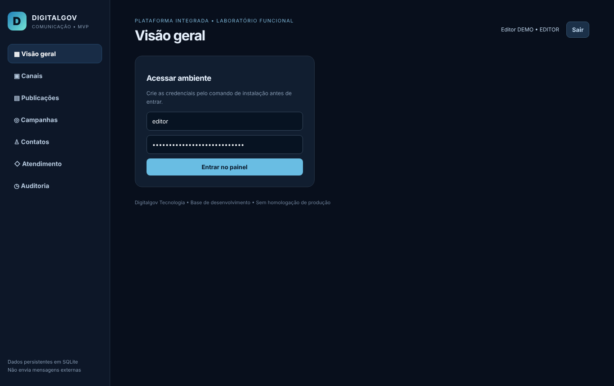
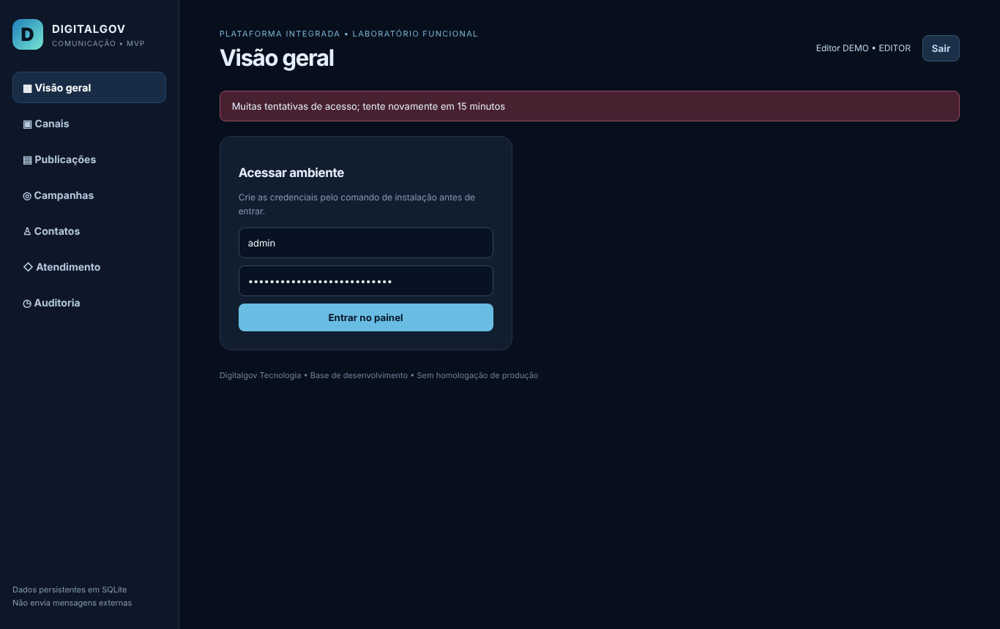
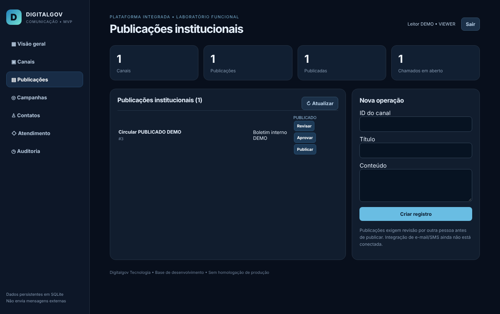
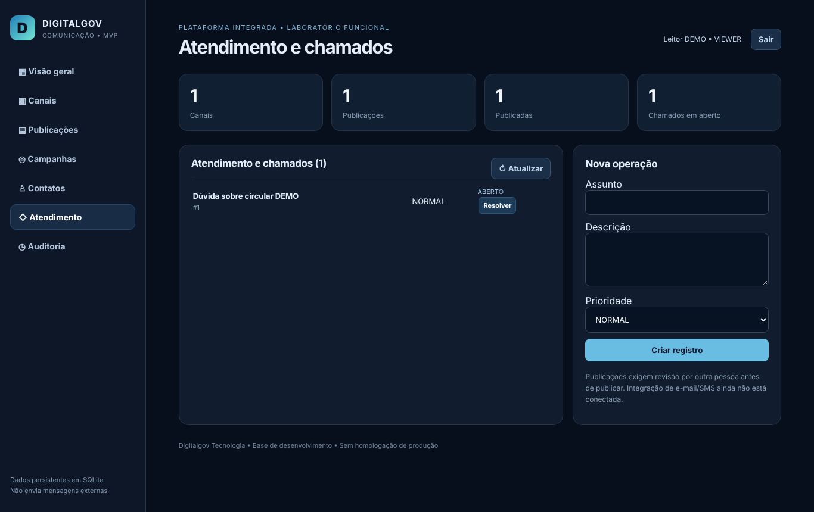
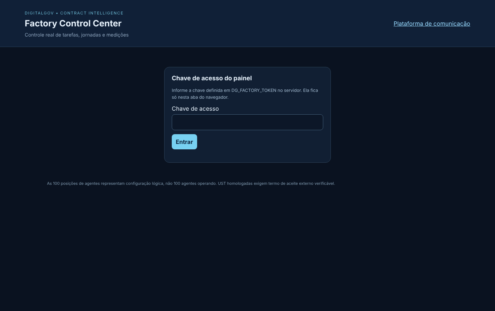
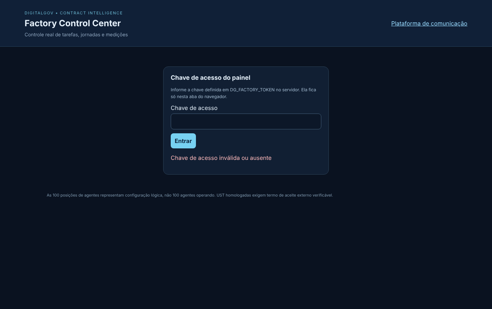

# Relatório Técnico de Execução e Medição — novembro de 2026

## 1. Situação do contrato

O ciclo é: **a empresa executa → o órgão confere e aceita → o órgão paga**. Cada etapa só avança quando a anterior tem registro.

| Etapa | UST | Valor | Situação |
|---|---|---|---|
| Contratado | 12.000 | — | total do contrato |
| Executado | 202,5 | R$ 6.075,00 | entregue, testado e auditado; vai para o aceite do órgão |
| Aceito pelo órgão | 0 | — | próxima etapa: o órgão confere o executado e emite o termo de aceite |
| Pago | 0 | — | depois do aceite (registre em PAGAMENTOS.csv) |
| **Saldo para executar** | **11.797,5** | | contratado − executado |
| ↳ já planejado | 0 | | 0 módulo(s) com data (seção 11) |
| ↳ ainda sem planejamento | 11.797,5 | | precisa de novas demandas/OS do órgão |

Em uma frase: de 12.000 UST contratadas, 202,5 já foram executadas (1,7%); 0 estão planejadas e 11.797,5 ainda não têm demanda.
> OS-FIC-002: Catálogo PROPOSTO-V1 aprovado pela contratada em 06/11/2026 (R$ 30,00 por UST), pendente de ratificação pelo órgão. A medição parcial (cada módulo dividido pelos itens de escopo do TR) é proposta da contratada e depende de confirmação. Sem OS assinada pelo órgão, nenhuma quantidade é considerada aceita.

## 2. Meta diária

- **Meta de hoje (13/11/2026):** 0 UST — nenhum módulo planejado para hoje.
- **Executado hoje:** 0 UST.

Como a meta é calculada: a UST de cada módulo do planejamento é dividida igualmente pelos dias úteis entre a data de início e a de fim; a meta do dia é a soma dos módulos em andamento naquele dia. O executado entra no dia em que o módulo foi medido.

| Dia | Meta (UST) | Executado (UST) | Meta acumulada | Executado acumulado |
|---|---|---|---|---|
| 06/11 | 0 | 202,5 | 0 | 202,5 |

## 3. Identificação

| Campo | Informação |
|---|---|
| Órgão | [EXISTE — nome e documentos a enviar pelo responsável] |
| Contrato | FIC-COM-2026-001 |
| Objeto | Plataforma Integrada de Comunicação Institucional e Atendimento Digital |
| Ordens de serviço | OS-FIC-002 — Correção e endurecimento da base (12 achados do diagnóstico) |
| Sistema(s) | contratos/FIC-COM-2026-001/laboratorio |
| Período | novembro de 2026 (até 13/11/2026) |
| Contratada | V4 Tecnologia Brasil · DigitalGov — CNPJ 24.361.188/0001-61 |
| Responsável técnico | Warley Luciano Costa Gomes |

## 4. Equipe técnica e agentes de IA

Os agentes de IA executam as etapas técnicas; a equipe técnica responde por eles: orienta, revisa e aprova. Participação individual só aparece quando há registro (commit, revisão, ata ou registro do gestor).

| Nome | Função | Responsabilidade | Desde | Participações registradas |
|---|---|---|---|---|
| Jerlian | Programador | — | — | nenhuma ainda |
| Ruan | Programador | — | — | nenhuma ainda |
| Arthur Miguel | Programador | — | — | nenhuma ainda |
| Warley | Programador | — | — | nenhuma ainda |
| Werverton | Programador | — | — | nenhuma ainda |
| João Miguel | Programador | — | — | nenhuma ainda |
| Warley C. | Programador | — | — | nenhuma ainda |

**Etapas da OS-FIC-002 executadas pelos agentes:**

| Etapa | Agente (papel na fábrica) | Resultado | Data | Situação |
|---|---|---|---|---|
| Código (banco, API, telas, testes) | G06/G07/G08 + gerador de cadastros | commits no git (autor: Claude) | 2026-11-06 | concluído |
| Conferência da autorização | G03 Gestor Contratual | autorização registrada | 2026-11-06 | concluído |
| Execução dos testes | G12 Engenheiro de Testes | 97 verificações aprovadas | 2026-11-06 | concluído |
| Registro dos commits | G17 Auditor de Evidências | 13 commits | 2026-11-06 | concluído |
| Auditoria das evidências | G17 Auditor de Evidências | 4 módulos aprovados | 2026-11-06 | concluído |
| Medição | G15 Medidor de UST | previsto 202.5 · comprovado 202.5 · aceito 0 | 2026-11-06 | concluído |
| Relatórios | G19 Gerador de Relatórios | relatório diário e fechamento gerados | 2026-11-06 | concluído |
| Checklist de qualidade | G20 Homologador Técnico | 18 controle(s) crítico(s) aguardam verificação humana — verifique e rode de novo com --aprovado-por "Nome (cargo)" | 2026-11-06 | aguardando a equipe |
| Pacote de entrega | G20 Homologador Técnico | — | — | pendente |

## 5. O que foi feito e quanto foi medido

| Módulo | O que foi entregue | Item do contrato | UST executada | Testes |
|---|---|---|---|---|
| MOD-001 — Controle de sessão (TR M01, item 2 de 4) | Banco de dados, Testes automatizados | CAT-M01-02 | 202,5 | 37 ok, 0 falha(s) |
| MOD-002 — Correções de validação e privacidade (M03, M05, M07, M08) | Banco de dados, Testes automatizados | CORRETIVA-SEM-ITEM | 0 | 36 ok, 0 falha(s) |
| MOD-003 — Base técnica — migrações versionadas, cabeçalhos de segurança, dependências | Infraestrutura, Banco de dados, Testes automatizados | CORRETIVA-SEM-ITEM | 0 | 12 ok, 0 falha(s) |
| MOD-004 — Painel da fábrica — chave de acesso (ferramenta interna) | Testes automatizados | INTERNO-FABRICA | 0 | 12 ok, 0 falha(s) |
| **Total** | | | **202,5** | |

### MOD-001 — Controle de sessão (TR M01, item 2 de 4)

- **Banco de dados:** estrutura e acesso a dados — 2 arquivo(s), 8 linhas.
- **Testes:** 37 executado(s), 0 falha(s) — APROVADO em 2026-11-06 (1 arquivo(s) de teste, 68 linhas).
- **Medição:** item CAT-M01-02 — M01 entrega 2 de 4: Controle de sessão: previsto 202,5, executado **202,5**, aceito 0 UST.
- **Commits:** `102fc9f` 2026-11-06 MOD-003: código da plataforma de comunicação organizado por camada e módulo; `532d886` 2026-11-06 MOD-001 MOD-002 MOD-003: sessão revogável, validações, privacidade e migrações (OS-FIC-002); `f823f56` 2026-11-06 fabrica: diagnóstico do pacote DIGITALGOV (contrato fictício FIC-COM-2026-001).
- **Responsável:** equipe técnica (Jerlian, Ruan, Arthur Miguel, Warley, Werverton, João Miguel, Warley C.); revisão individual deste módulo: sem registro.

### MOD-002 — Correções de validação e privacidade (M03, M05, M07, M08)

- **Banco de dados:** estrutura e acesso a dados — 2 arquivo(s), 9 linhas.
- **Testes:** 36 executado(s), 0 falha(s) — APROVADO em 2026-11-06 (1 arquivo(s) de teste, 74 linhas).
- **Medição:** item CORRETIVA-SEM-ITEM — Correção de defeito em código preexistente — sem item no catálogo: previsto 0, executado **0**, aceito 0 UST.
- **Commits:** `102fc9f` 2026-11-06 MOD-003: código da plataforma de comunicação organizado por camada e módulo; `532d886` 2026-11-06 MOD-001 MOD-002 MOD-003: sessão revogável, validações, privacidade e migrações (OS-FIC-002); `f823f56` 2026-11-06 fabrica: diagnóstico do pacote DIGITALGOV (contrato fictício FIC-COM-2026-001).
- **Responsável:** equipe técnica (Jerlian, Ruan, Arthur Miguel, Warley, Werverton, João Miguel, Warley C.); revisão individual deste módulo: sem registro.

### MOD-003 — Base técnica — migrações versionadas, cabeçalhos de segurança, dependências

- **Banco de dados:** estrutura e acesso a dados — 3 arquivo(s), 40 linhas.
- **Infraestrutura:** 8 arquivo(s), 234 linhas.
- **Testes:** 12 executado(s), 0 falha(s) — APROVADO em 2026-11-06 (3 arquivo(s) de teste, 165 linhas).
- **Medição:** item CORRETIVA-SEM-ITEM — Correção de defeito em código preexistente — sem item no catálogo: previsto 0, executado **0**, aceito 0 UST.
- **Commits:** `91613ad` 2026-11-06 MOD-003: implantação, backup, manuais e CI da plataforma de comunicação; `102fc9f` 2026-11-06 MOD-003: código da plataforma de comunicação organizado por camada e módulo; `532d886` 2026-11-06 MOD-001 MOD-002 MOD-003: sessão revogável, validações, privacidade e migrações (OS-FIC-002); `f823f56` 2026-11-06 fabrica: diagnóstico do pacote DIGITALGOV (contrato fictício FIC-COM-2026-001).
- **Responsável:** equipe técnica (Jerlian, Ruan, Arthur Miguel, Warley, Werverton, João Miguel, Warley C.); revisão individual deste módulo: sem registro.

### MOD-004 — Painel da fábrica — chave de acesso (ferramenta interna)

- **Testes:** 12 executado(s), 0 falha(s) — APROVADO em 2026-11-06 (3 arquivo(s) de teste, 130 linhas).
- **Medição:** item INTERNO-FABRICA — Ferramenta interna da contratada (painel da fábrica) — não é entregável do contrato: previsto 0, executado **0**, aceito 0 UST.
- **Commits:** `91613ad` 2026-11-06 MOD-003: implantação, backup, manuais e CI da plataforma de comunicação; `de17ba0` 2026-11-06 MOD-004: painel da fábrica exige chave de acesso (OS-FIC-002); `f823f56` 2026-11-06 fabrica: diagnóstico do pacote DIGITALGOV (contrato fictício FIC-COM-2026-001).
- **Responsável:** equipe técnica (Jerlian, Ruan, Arthur Miguel, Warley, Werverton, João Miguel, Warley C.); revisão individual deste módulo: sem registro.

## 6. De onde vêm os números (memória de cálculo)

1. **O contrato define o catálogo de serviços** (`CATALOGO_SERVICOS.csv`): para cada serviço, quantas horas de cada perfil ele consome.
2. **A quantidade de cada módulo está definida na OS / tabela do contrato** (`TABELA_UST.csv`).
3. **A fórmula do contrato é `definida na OS`**.
4. **A OS diz quais serviços cada módulo usa.**
5. **O módulo só conta como executado** quando o código está no git, os testes passaram e a auditoria das evidências aprovou. Linhas de código não entram na conta.

| Módulo | Serviço | Conta | UST | Valor |
|---|---|---|---|---|
| MOD-001 | CAT-M01-02 | previsto=202.5 UST (OS OS-FIC-002, item CAT-M01-02) | 202,5 | R$ 6.075,00 |
| MOD-002 | CORRETIVA-SEM-ITEM | previsto=0 UST (OS OS-FIC-002, item CORRETIVA-SEM-ITEM) | 0 | — |
| MOD-003 | CORRETIVA-SEM-ITEM | previsto=0 UST (OS OS-FIC-002, item CORRETIVA-SEM-ITEM) | 0 | — |
| MOD-004 | INTERNO-FABRICA | previsto=0 UST (OS OS-FIC-002, item INTERNO-FABRICA) | 0 | — |

Exemplo de leitura: "4 h Analista × 1,2" significa 4 horas do perfil Analista, que valem 1,2 UST por hora = 4,8 UST.

## 7. Divisão das UST executadas pela equipe

Regra: em cada módulo, as UST executadas são divididas entre as pessoas que participaram dele, na proporção do peso. Peso = tipo de participação × senioridade. Tipos: condução 3, correção 2, revisão 1, orientação 1, aprovação 1; senioridade: especialista ×1.5, senior ×1.5, pleno ×1.0, junior ×0.7. Fonte: `PARTICIPACOES.csv` (preenchido pelo documento de participação). É divisão interna da empresa: não muda a medição nem o aceite.

Não atribuído (módulos sem participação registrada): 202,5 UST — MOD-001.

## 8. Tecnologias utilizadas

| Camada | Tecnologias | Fonte |
|---|---|---|
| Backend (Python) | fastapi, uvicorn, python-docx | `contratos/FIC-COM-2026-001/laboratorio/FABRICA/requirements.txt` |
| Backend (Python) | fastapi, uvicorn, pydantic | `contratos/FIC-COM-2026-001/laboratorio/PLATAFORMA_COMUNICACAO/requirements.txt` |
| Infraestrutura (contêineres) | nginx:1.27-alpine | `contratos/FIC-COM-2026-001/laboratorio/docker-compose.yml` |

## 9. Código de novembro de 2026

**contratos/FIC-COM-2026-001/laboratorio:** 6 commit(s), +5276 / −400 linhas.

| Camada | Arquivos alterados | Linhas adicionadas | Linhas removidas |
|---|---|---|---|
| Outros | 70 | 4187 | 371 |
| Testes automatizados | 11 | 481 | 6 |
| Documentação | 9 | 263 | 1 |
| Infraestrutura (Docker, proxy, CI) | 10 | 246 | 0 |
| Banco de dados | 10 | 99 | 22 |

| Commit | Data | Descrição |
|---|---|---|
| `91613ad` | 2026-11-06 | MOD-003: implantação, backup, manuais e CI da plataforma de comunicação |
| `102fc9f` | 2026-11-06 | MOD-003: código da plataforma de comunicação organizado por camada e módulo |
| `c650bf4` | 2026-11-06 | fabrica: OS-FIC-002 executada, auditada e medida (FIC-COM-2026-001) |
| `de17ba0` | 2026-11-06 | MOD-004: painel da fábrica exige chave de acesso (OS-FIC-002) |
| `532d886` | 2026-11-06 | MOD-001 MOD-002 MOD-003: sessão revogável, validações, privacidade e migrações (OS-FIC-002) |
| `f823f56` | 2026-11-06 | fabrica: diagnóstico do pacote DIGITALGOV (contrato fictício FIC-COM-2026-001) |

### Código de hoje (13/11/2026)

**contratos/FIC-COM-2026-001/laboratorio:** 0 commit(s), +0 / −0 linhas.

## 10. Código total do sistema

**contratos/FIC-COM-2026-001/laboratorio:** 87 arquivo(s), 5045 linhas, 6 commit(s) desde o início.

| Camada | Arquivos | Linhas |
|---|---|---|
| Outros | 53 | 3985 |
| Testes automatizados | 9 | 475 |
| Documentação | 7 | 262 |
| Infraestrutura (Docker, proxy, CI) | 10 | 246 |
| Banco de dados | 8 | 77 |

| Linguagem | Arquivos | Linhas |
|---|---|---|
| Python | 35 | 1701 |
| JSON | 4 | 1523 |
| JavaScript | 5 | 418 |
| Outros | 12 | 364 |
| CSS | 2 | 357 |
| Markdown | 7 | 262 |
| Shell | 3 | 94 |
| YAML | 3 | 92 |
| HTML | 2 | 78 |
| Configuração | 2 | 77 |
| SQL | 6 | 34 |
| Docker | 2 | 33 |
| Texto | 4 | 12 |

> Linhas de código e commits mostram o tamanho do trabalho; a quantidade medida vem do catálogo do contrato, não das linhas.

## 11. A fazer (planejado)

Nenhum módulo planejado além do que já foi executado.

## 12. Próximas etapas e pendências

- Próxima etapa normal: enviar ao órgão os 202,5 UST executados para conferência e termo de aceite.
- OS-FIC-002: a equipe técnica verifica o checklist — 18 controle(s) crítico(s) aguardam verificação humana — verifique e rode de novo com --aprovado-por "Nome (cargo)".
- Registrar a revisão de cada módulo por um membro da equipe (MOD-001, MOD-002, MOD-003, MOD-004) em PARTICIPACOES.csv (data, pessoa, módulo, tipo REVISAO/APROVACAO, evidência).

## 13. Arquivos de origem

- UST: `medicoes/<OS>.json` (medição pelo catálogo do contrato) e `contrato.yaml`.
- O que foi feito, código e commits: repositório git (`git log`, `git ls-files`).
- Testes: `evidencias/<OS>/<MÓDULO>/TESTES.json` (execuções reais com JUnit).
- Telas: capturas reais em `evidencias/<OS>/<MÓDULO>/SCREENSHOTS/`.
- A fazer e meta diária: `PLANEJAMENTO.csv` (estimativa pelo catálogo, datas de início e fim).
- Pagamentos: `PAGAMENTOS.csv` (data, competência, UST, valor e documento do pagamento).

