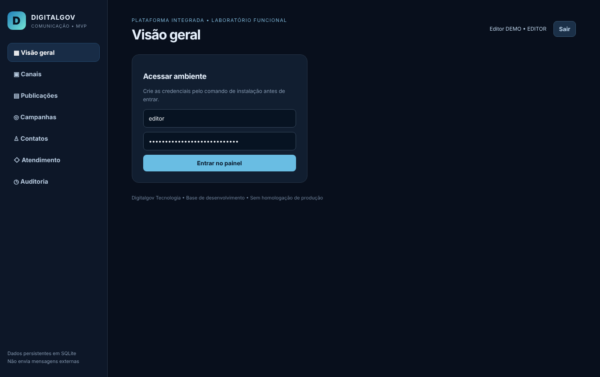
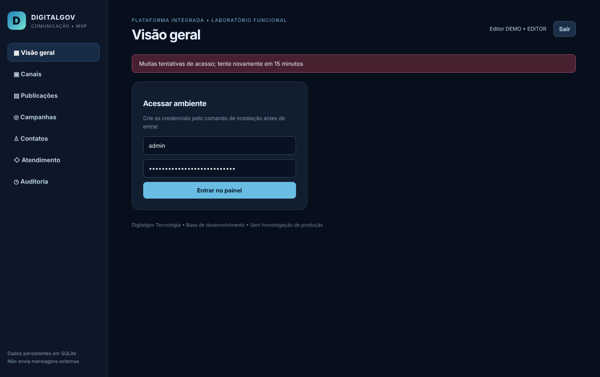

# Relatório mensal de medição ao órgão — novembro de 2026

| Campo | Informação |
|---|---|
| Órgão | [EXISTE — nome e documentos a enviar pelo responsável] |
| Contrato | FIC-COM-2026-001 (referência fictícia) |
| Objeto | Plataforma Integrada de Comunicação Institucional e Atendimento Digital, 18 módulos do TR (minuta cl. 2) |
| Período | novembro de 2026 |
| Unidade de medição | UST · valor unitário R$ 30,00 |

## 1. Resumo da medição

| Indicador | No período | Acumulado no contrato |
|---|---|---|
| Executado e comprovado (UST) | 202,5 | 202,5 |
| Valor correspondente | R$ 6.075,00 | R$ 6.075,00 |
| Aceito pelo órgão (UST) | 0 | 0 |
| Pago (UST) | — | 0 |
| Saldo a executar (UST) | — | 11.797,5 |

Comprovado = serviço entregue, com código versionado, testes executados sem falha e evidências aprovadas na auditoria. A quantidade só é devida depois da conferência e do termo de aceite do órgão.

## 2. Itens medidos no período

| OS | Módulo | Item do catálogo | UST | Valor | Comprovado em | Aceite |
|---|---|---|---|---|---|---|
| OS-FIC-002 | MOD-001 Controle de sessão (TR M01, item 2 de 4) | CAT-M01-SESSAO | 202,5 | R$ 6.075,00 | 2026-11-06 14:24 | PENDENTE |
| **Total** | | | **202,5** | **R$ 6.075,00** | | |

## 3. Memória de cálculo

- **MOD-001** — item `CAT-M01-SESSAO` (M01 item 2 de 4: controle de sessão (810 ÷ 4); referência: TR seção 3 M01 escopo: RBAC; controle de sessão; MFA/SSO; segregação editorial): 202,5 UST conforme a OS OS-FIC-002 × R$ 30,00 = R$ 6.075,00.

**Observações da medição:**

- Catálogo PROPOSTO-V1 aprovado pela contratada em 06/11/2026 (R$ 30,00 por UST), pendente de ratificação pelo órgão. A medição parcial (cada módulo dividido pelos itens de escopo do TR) é proposta da contratada e depende de confirmação. Sem OS assinada pelo órgão, nenhuma quantidade é considerada aceita.

## 4. Provas de cada item

### MOD-001 — Controle de sessão (TR M01, item 2 de 4)

- **Ordem de serviço:** OS-FIC-002, autorizada por Responsável técnico da contratada (autorização interna; conta fabricagovv@gmail.com) em 2026-11-06 (Autorização interna registrada em 06/11/2026 na sessão de trabalho Claude Code (decisão D-0004); OS do órgão pendente).
- **Testes:** 35 testes executados, 0 falha(s), em 2026-11-06 14:15 — APROVADO.
- **Auditoria das evidências:** APROVADO em 2026-11-06 14:24.
- **Revisão humana:** pendente — sem registro.
- **Aceite do órgão:** PENDENTE.

| Commit | Data e hora | Descrição |
|---|---|---|
| `532d886010` | 2026-11-06 14:14 | MOD-001 MOD-002 MOD-003: sessão revogável, validações, privacidade e migrações (OS-FIC-002) |

Linha de base excluída das provas (código que já existia): `f823f56b52`.

## 5. Manifesto de provas (SHA-256)

Cada arquivo pode ser conferido recalculando o SHA-256; qualquer alteração muda o código.

| Módulo | Arquivo | SHA-256 |
|---|---|---|
| MOD-001 | `OS-FIC-002/MOD-001/TESTES.json` | `da97df2d756dcc4c4f13f60338a9d3901874a4e2ed5e196c539ed46c95d9140a` |
| MOD-001 | `OS-FIC-002/MOD-001/COMMITS.json` | `c11aea0e9b772d58db6096c30f3890394eadd4205d04f422eea5c51f8364ceb8` |
| MOD-001 | `contratos/FIC-COM-2026-001/medicoes/OS-FIC-002.json` | `27646167a59bf72622b8440f437fbb2d76b7f9cfb3b9a28072d67857d6c310d0` |
| MOD-001 | `OS-FIC-002/MOD-001/LOGS_TESTES/sessao-20261106T141506.xml` | `f8912eccb8560155117b7bad5e46f661045a1c8449e996755051caee0e78a1b6` |
| MOD-001 | `OS-FIC-002/MOD-001/LOGS_TESTES/sessao-20261106T141506.log` | `bdf420748a59c6de462e1e2f5d5e26e03ee1bf209036fd51e6c9d7dd9236a5c0` |
| MOD-001 | `OS-FIC-002/MOD-001/LOGS_TESTES/regressao-comunicacao-20261106T141510.xml` | `bacf863f2baa16d005cdc28071f0efecedfd4ea2191141aeeea2fb29f25cfbcc` |
| MOD-001 | `OS-FIC-002/MOD-001/LOGS_TESTES/regressao-comunicacao-20261106T141510.log` | `cc2782714feff08bcf88e9060f9baed71f17cb1ae7a290b3f1c0c9ddfb82e999` |
| MOD-001 | `OS-FIC-002/MOD-001/SCREENSHOTS/MOD-001_01_apos_sair.png` | `557dff6bbd5026c6ffa34743d766abbaa64b34df2842d513b134fadd8ae230a9` |
| MOD-001 | `OS-FIC-002/MOD-001/SCREENSHOTS/MOD-001_02_bloqueio_tentativas.png` | `87065ab9cd2766e75281c6ff00ac24be6c965fa4e5dca2b37be46cc9b7b7eca8` |

## 6. Pendências para o aceite

- Conferência e termo de aceite do órgão para 202,5 UST comprovados.
- Revisão humana dos itens pela equipe técnica (registro em andamento).

## 7. Declaração

Declaramos que as quantidades deste relatório correspondem a serviços executados e comprovados por código versionado, testes executados e evidências auditadas, listados acima com seus códigos de verificação. Nenhuma quantidade foi incluída sem prova, e nenhuma quantidade é considerada aceita sem o termo do órgão.
