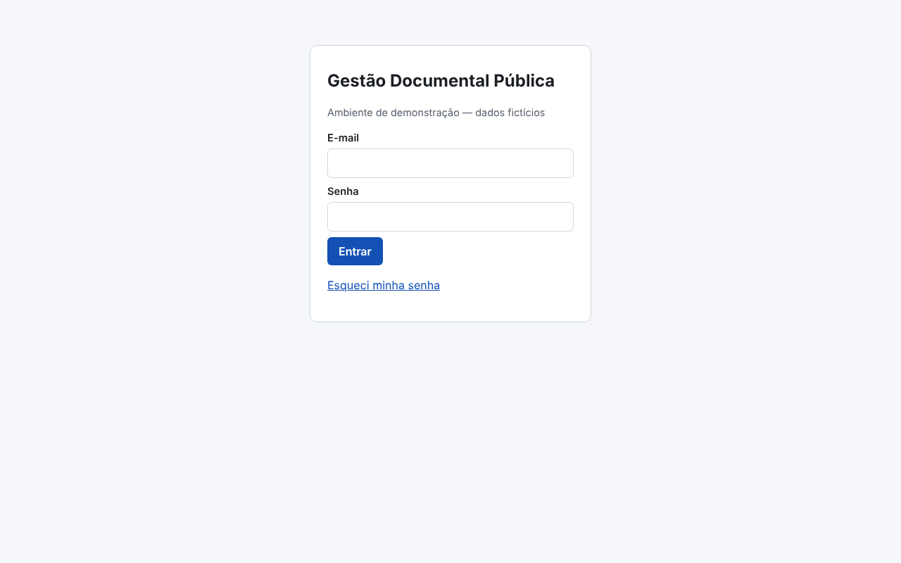
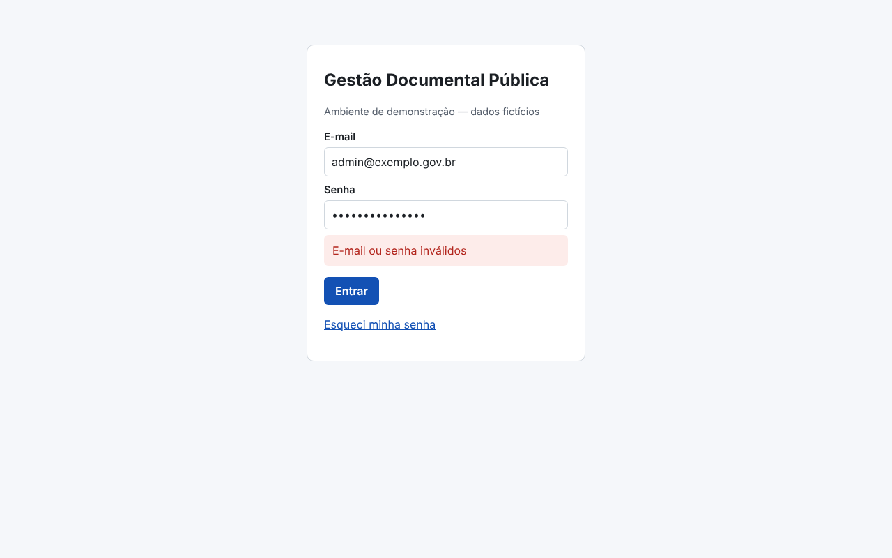
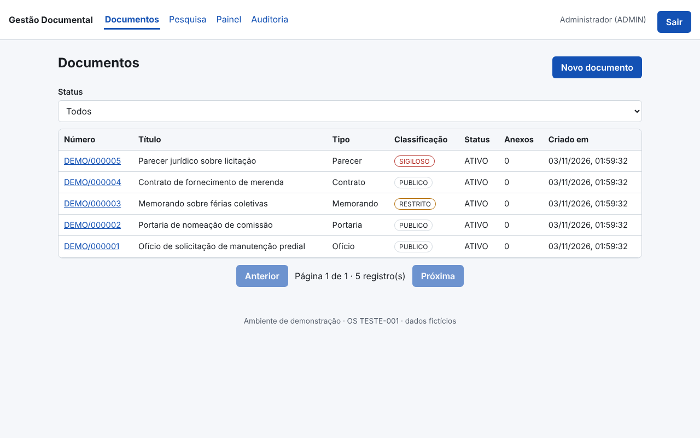
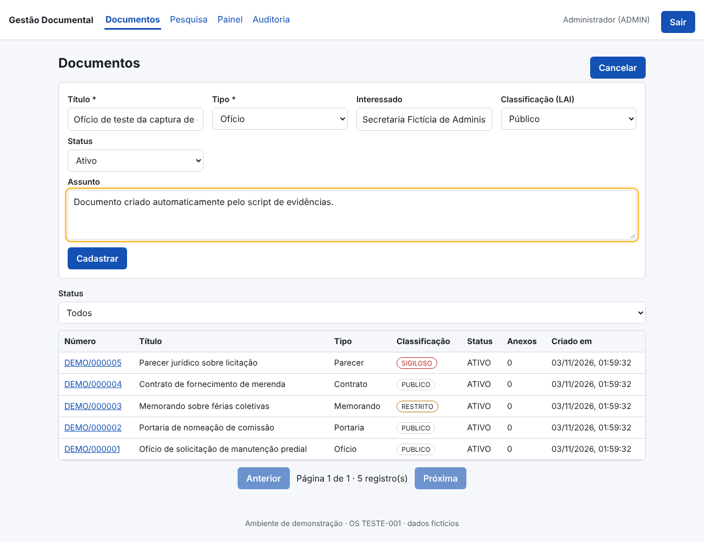
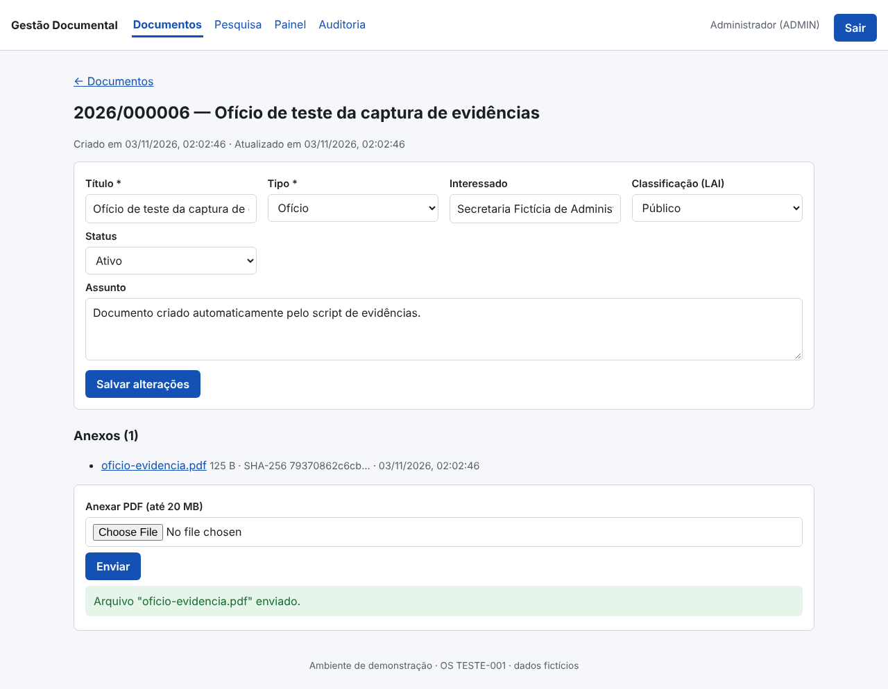
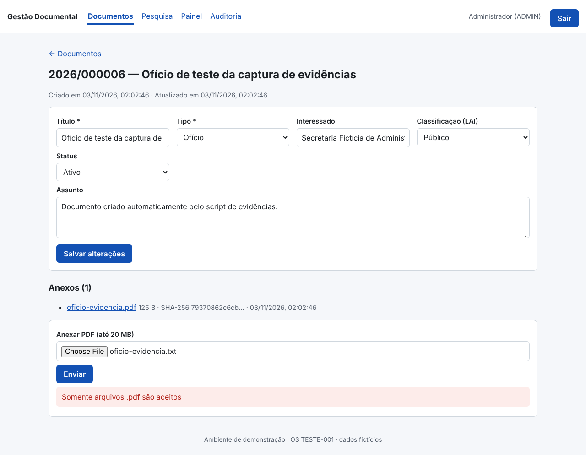
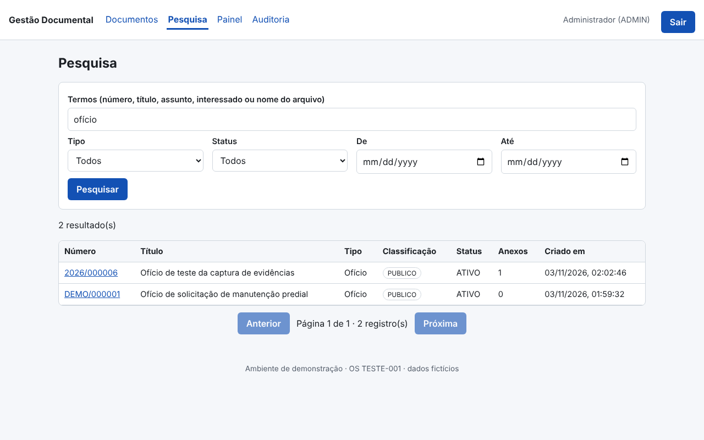
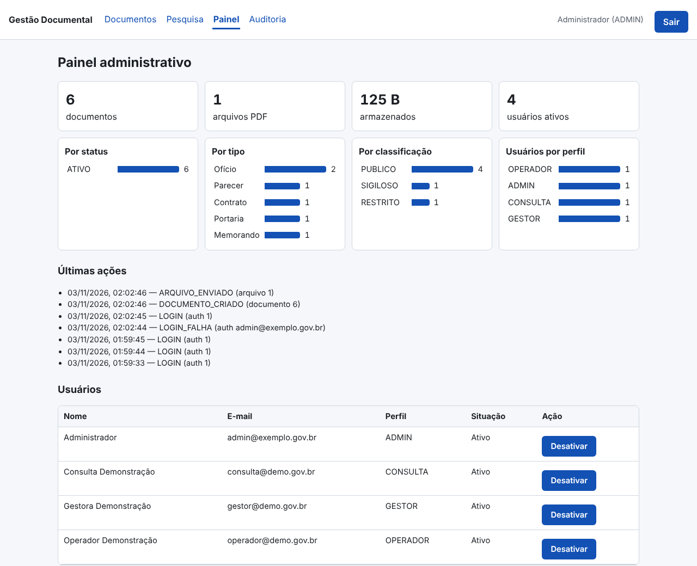
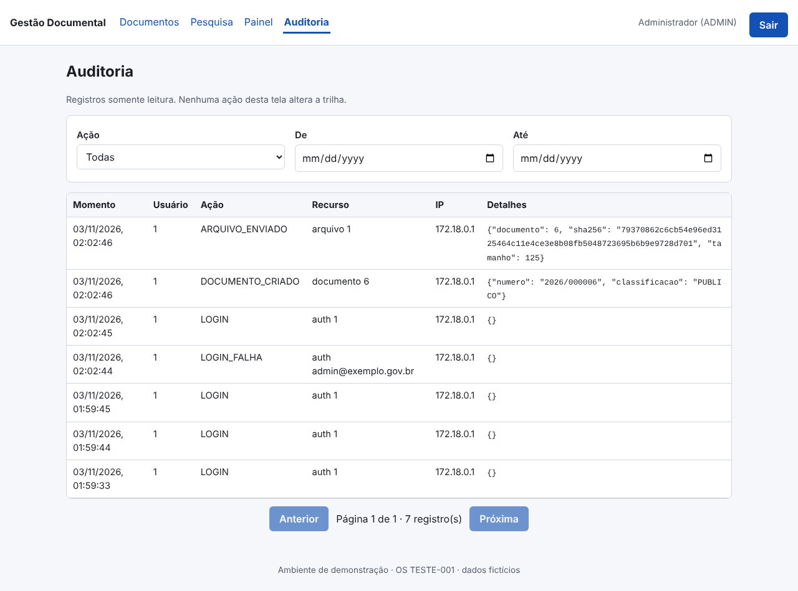

# Relatório Técnico de Execução e Medição — novembro de 2026

## 1. Situação do contrato

O ciclo é: **a empresa executa → o órgão confere e aceita → o órgão paga**. Cada etapa só avança quando a anterior tem registro.

| Etapa | UST | Valor | Situação |
|---|---|---|---|
| Contratado | 10 | — | total do contrato |
| Executado | 10 | — | entregue, testado e auditado; vai para o aceite do órgão |
| Aceito pelo órgão | 0 | — | próxima etapa: o órgão confere o executado e emite o termo de aceite |
| Pago | 0 | — | depois do aceite (registre em PAGAMENTOS.csv) |
| **Saldo para executar** | **0** | | contratado − executado |
| ↳ já planejado | 0 | | 0 módulo(s) com data (seção 11) |
| ↳ ainda sem planejamento | 0 | | precisa de novas demandas/OS do órgão |

Em uma frase: de 10 UST contratadas, 10 já foram executadas (100%); 0 estão planejadas e 0 ainda não têm demanda.
> OS-TESTE-001: UST FICTÍCIAS — demonstração da fábrica, sem valor para faturamento.

## 2. Meta diária

- **Meta de hoje (09/11/2026):** 0 UST — nenhum módulo planejado para hoje.
- **Executado hoje:** 0 UST.
- **Ritmo para executar todo o saldo até o fim da vigência (31/12/2026):** 0 UST por dia útil (39 dias úteis).

Como a meta é calculada: a UST de cada módulo do planejamento é dividida igualmente pelos dias úteis entre a data de início e a de fim; a meta do dia é a soma dos módulos em andamento naquele dia. O executado entra no dia em que o módulo foi medido.

| Dia | Meta (UST) | Executado (UST) | Meta acumulada | Executado acumulado |
|---|---|---|---|---|
| 03/11 | 0 | 10 | 0 | 10 |

## 3. Identificação

| Campo | Informação |
|---|---|
| Órgão | Órgão Fictício de Demonstração |
| Contrato | TESTE-001 |
| Objeto | Desenvolvimento de sistema de Gestão Documental Pública (demonstração da fábrica) |
| Ordens de serviço | OS-TESTE-001 — Gestão Documental Pública |
| Sistema(s) | projetos/gestao-documental |
| Período | novembro de 2026 (até 09/11/2026) |
| Contratada | V4 Tecnologia Brasil · DigitalGov — CNPJ 24.361.188/0001-61 |
| Responsável técnico | Warley Luciano Costa Gomes |

## 4. Equipe técnica e agentes de IA

Os agentes de IA executam as etapas técnicas; a equipe técnica responde por eles: orienta, revisa e aprova. Participação individual só aparece quando há registro (commit, revisão, ata ou registro do gestor).

Equipe técnica: sem registro (cadastre com `fabrica.py profissionais adicionar`).

**Etapas da OS-TESTE-001 executadas pelos agentes:**

| Etapa | Agente (papel na fábrica) | Resultado | Data | Situação |
|---|---|---|---|---|
| Código (banco, API, telas, testes) | G06/G07/G08 + gerador de cadastros | commits no git (autor: Claude) | 2026-11-03 | concluído |
| Conferência da autorização | G03 Gestor Contratual | — | — | sem registro |
| Execução dos testes | G12 Engenheiro de Testes | — | — | sem registro |
| Registro dos commits | G17 Auditor de Evidências | — | — | sem registro |
| Auditoria das evidências | G17 Auditor de Evidências | — | — | sem registro |
| Medição | G15 Medidor de UST | — | — | sem registro |
| Relatórios | G19 Gerador de Relatórios | — | — | sem registro |
| Checklist de qualidade | G20 Homologador Técnico | — | — | sem registro |
| Pacote de entrega | G20 Homologador Técnico | — | — | sem registro |

## 5. O que foi feito e quanto foi medido

| Módulo | O que foi entregue | Item do contrato | UST executada | Testes |
|---|---|---|---|---|
| MOD-001 — Autenticação e controle de acesso | API e regras de negócio, Testes automatizados, Telas | UST-TESTE-MOD | 2 | 20 ok, 0 falha(s) |
| MOD-002 — Cadastro documental | API e regras de negócio, Testes automatizados, Telas | UST-TESTE-MOD | 2 | 11 ok, 0 falha(s) |
| MOD-003 — Upload de PDF | API e regras de negócio, Testes automatizados, Telas | UST-TESTE-MOD | 2 | 11 ok, 0 falha(s) |
| MOD-004 — Pesquisa | API e regras de negócio, Testes automatizados, Telas | UST-TESTE-MOD | 1 | 7 ok, 0 falha(s) |
| MOD-005 — Painel administrativo | API e regras de negócio, Testes automatizados, Telas | UST-TESTE-MOD | 1 | 3 ok, 0 falha(s) |
| MOD-006 — Auditoria | API e regras de negócio, Testes automatizados, Telas | UST-TESTE-MOD | 1 | 7 ok, 0 falha(s) |
| MOD-007 — Infraestrutura e documentação | Infraestrutura, Banco de dados, API e regras de negócio, Testes automatizados, Telas | UST-TESTE-INFRA | 1 | 28 ok, 0 falha(s) |
| **Total** | | | **10** | |

### MOD-001 — Autenticação e controle de acesso

- **API (backend):** 9 rota(s): `POST /api/auth/login`, `POST /api/auth/logout`, `GET /api/auth/me`, `POST /api/auth/recuperar-senha`, `POST /api/auth/redefinir-senha`, `GET /api/usuarios`, `GET /api/usuarios/perfis`, `POST /api/usuarios` e outras — 5 arquivo(s), 306 linhas.
- **Telas (frontend):** auth, EsqueciSenha, Login, RedefinirSenha — 4 arquivo(s), 164 linhas.
- **Testes:** 20 executado(s), 0 falha(s) — APROVADO em 2026-11-02 (2 arquivo(s) de teste, 165 linhas).
- **Medição:** item UST-TESTE-MOD — Desenvolvimento de módulo funcional (FICTÍCIO): previsto 2, executado **2**, aceito 0 UST.
- **Commits:** `0c1c851` 2026-11-03 MOD-001: autenticação, logout, recuperação de senha, perfis e permissões.
- **Responsável:** sem registro.

### MOD-002 — Cadastro documental

- **API (backend):** 5 rota(s): `GET /api/documentos`, `POST /api/documentos`, `GET /api/documentos/{did}`, `PATCH /api/documentos/{did}`, `DELETE /api/documentos/{did}` — 1 arquivo(s), 94 linhas.
- **Telas (frontend):** DocumentoDetalhe, Documentos, FormDocumento — 3 arquivo(s), 142 linhas.
- **Testes:** 11 executado(s), 0 falha(s) — APROVADO em 2026-11-02 (2 arquivo(s) de teste, 99 linhas).
- **Medição:** item UST-TESTE-MOD — Desenvolvimento de módulo funcional (FICTÍCIO): previsto 2, executado **2**, aceito 0 UST.
- **Commits:** `e419dae` 2026-11-03 MOD-002: cadastro documental com classificação LAI e arquivamento lógico.
- **Responsável:** sem registro.

### MOD-003 — Upload de PDF

- **API (backend):** 2 rota(s): `POST /api/documentos/{did}/arquivos`, `GET /api/arquivos/{aid}` — 2 arquivo(s), 127 linhas.
- **Telas (frontend):** UploadPdf — 1 arquivo(s), 52 linhas.
- **Testes:** 11 executado(s), 0 falha(s) — APROVADO em 2026-11-02 (2 arquivo(s) de teste, 69 linhas).
- **Medição:** item UST-TESTE-MOD — Desenvolvimento de módulo funcional (FICTÍCIO): previsto 2, executado **2**, aceito 0 UST.
- **Commits:** `348ec80` 2026-11-03 MOD-003: upload de PDF com validação de assinatura, limite e SHA-256.
- **Responsável:** sem registro.

### MOD-004 — Pesquisa

- **API (backend):** 2 rota(s): `GET /api/pesquisa`, `GET /api/pesquisa/tipos` — 1 arquivo(s), 60 linhas.
- **Telas (frontend):** Pesquisa — 1 arquivo(s), 41 linhas.
- **Testes:** 7 executado(s), 0 falha(s) — APROVADO em 2026-11-02 (2 arquivo(s) de teste, 74 linhas).
- **Medição:** item UST-TESTE-MOD — Desenvolvimento de módulo funcional (FICTÍCIO): previsto 1, executado **1**, aceito 0 UST.
- **Commits:** `0ca859e` 2026-11-03 MOD-004: pesquisa por termos e filtros respeitando classificação.
- **Responsável:** sem registro.

### MOD-005 — Painel administrativo

- **API (backend):** 1 rota(s): `GET /api/painel/resumo` — 1 arquivo(s), 33 linhas.
- **Telas (frontend):** Painel — 1 arquivo(s), 98 linhas.
- **Testes:** 3 executado(s), 0 falha(s) — APROVADO em 2026-11-02 (2 arquivo(s) de teste, 45 linhas).
- **Medição:** item UST-TESTE-MOD — Desenvolvimento de módulo funcional (FICTÍCIO): previsto 1, executado **1**, aceito 0 UST.
- **Commits:** `3cbdf19` 2026-11-03 MOD-005: painel administrativo com indicadores e gestão de usuários.
- **Responsável:** sem registro.

### MOD-006 — Auditoria

- **API (backend):** 2 rota(s): `GET /api/auditoria`, `GET /api/auditoria/acoes` — 2 arquivo(s), 74 linhas.
- **Telas (frontend):** Auditoria — 1 arquivo(s), 39 linhas.
- **Testes:** 7 executado(s), 0 falha(s) — APROVADO em 2026-11-02 (2 arquivo(s) de teste, 75 linhas).
- **Medição:** item UST-TESTE-MOD — Desenvolvimento de módulo funcional (FICTÍCIO): previsto 1, executado **1**, aceito 0 UST.
- **Commits:** `e10e719` 2026-11-03 MOD-006: trilha de auditoria somente inserção e tela de consulta.
- **Responsável:** sem registro.

### MOD-007 — Infraestrutura e documentação

- **Banco de dados:** tabela(s) `usuarios`, `tokens_recuperacao`, `tokens_revogados`, `documentos`, `arquivos`, `auditoria`, `interessados`, `protocolos` — 10 arquivo(s), 487 linhas.
- **API (backend):** 2 rota(s): `GET /api/health`, `GET /api/health/db` — 9 arquivo(s), 328 linhas.
- **Telas (frontend):** App, Alerta, Paginacao, TabelaDocumentos, main — 11 arquivo(s), 336 linhas.
- **Infraestrutura:** 12 arquivo(s), 309 linhas.
- **Testes:** 28 executado(s), 0 falha(s) — APROVADO em 2026-11-02 (4 arquivo(s) de teste, 179 linhas).
- **Medição:** item UST-TESTE-INFRA — Infraestrutura e documentação (FICTÍCIO): previsto 1, executado **1**, aceito 0 UST.
- **Commits:** `6e7928a` 2026-11-03 MOD-102: lista mostra o nome do interessado; mensagens de validação sem prefixo técnico (gerador corrigido); `7313248` 2026-11-03 MOD-102: cadastro de protocolos com relacionamento a interessados (gerado da especificação); `83e7978` 2026-11-03 MOD-101: cadastro de interessados (gerado da especificação: modelo, migração, API, auditoria, tela e testes); `ea7f8f4` 2026-11-03 MOD-100: base modular — descoberta automática de módulos, validadores CPF/CNPJ e permissão por perfil (+1).
- **Responsável:** sem registro.

## 6. De onde vêm os números (memória de cálculo)

1. **O contrato define o catálogo de serviços** (`CATALOGO_SERVICOS.csv`): para cada serviço, quantas horas de cada perfil ele consome.
2. **A quantidade de cada módulo está definida na OS / tabela do contrato** (`TABELA_UST.csv`).
3. **A fórmula do contrato é `definida na OS`**.
4. **A OS diz quais serviços cada módulo usa.**
5. **O módulo só conta como executado** quando o código está no git, os testes passaram e a auditoria das evidências aprovou. Linhas de código não entram na conta.

| Módulo | Serviço | Conta | UST | Valor |
|---|---|---|---|---|
| MOD-001 | UST-TESTE-MOD | previsto=2 UST (OS OS-TESTE-001, item UST-TESTE-MOD) | 2 | — |
| MOD-002 | UST-TESTE-MOD | previsto=2 UST (OS OS-TESTE-001, item UST-TESTE-MOD) | 2 | — |
| MOD-003 | UST-TESTE-MOD | previsto=2 UST (OS OS-TESTE-001, item UST-TESTE-MOD) | 2 | — |
| MOD-004 | UST-TESTE-MOD | previsto=1 UST (OS OS-TESTE-001, item UST-TESTE-MOD) | 1 | — |
| MOD-005 | UST-TESTE-MOD | previsto=1 UST (OS OS-TESTE-001, item UST-TESTE-MOD) | 1 | — |
| MOD-006 | UST-TESTE-MOD | previsto=1 UST (OS OS-TESTE-001, item UST-TESTE-MOD) | 1 | — |
| MOD-007 | UST-TESTE-INFRA | previsto=1 UST (OS OS-TESTE-001, item UST-TESTE-INFRA) | 1 | — |

Exemplo de leitura: "4 h Analista × 1,2" significa 4 horas do perfil Analista, que valem 1,2 UST por hora = 4,8 UST.

## 7. Divisão das UST executadas pela equipe

Regra: em cada módulo, as UST executadas são divididas entre as pessoas que participaram dele, na proporção do peso. Peso = tipo de participação × senioridade. Tipos: condução 3, correção 2, revisão 1, orientação 1, aprovação 1; senioridade: especialista ×1.5, senior ×1.5, pleno ×1.0, junior ×0.7. Fonte: `PARTICIPACOES.csv` (preenchido pelo documento de participação). É divisão interna da empresa: não muda a medição nem o aceite.

Não atribuído (módulos sem participação registrada): 10 UST — MOD-001, MOD-002, MOD-003, MOD-004, MOD-005, MOD-006, MOD-007.

## 8. Tecnologias utilizadas

| Camada | Tecnologias | Fonte |
|---|---|---|
| Exigidas no contrato | React, FastAPI, PostgreSQL | `contrato.yaml` |
| Banco de dados | PostgreSQL 16 | `contrato.yaml` |
| Backend (Python) | fastapi, uvicorn, sqlalchemy, alembic, psycopg2-binary, pydantic, python-multipart, bcrypt, pyjwt | `projetos/gestao-documental/backend/requirements.txt` |
| Frontend (TypeScript/React) | react, react-dom, react-router-dom | `projetos/gestao-documental/frontend/package.json` |
| Build e testes de tela | @testing-library/dom, @testing-library/react, @testing-library/user-event, @types/node, @types/react, @types/react-dom, @vitejs/plugin-react, jsdom, typescript, vite, vitest | `projetos/gestao-documental/frontend/package.json` |
| Infraestrutura (contêineres) | nginx:1.27-alpine | `projetos/gestao-documental/docker-compose.prod.yml` |
| Infraestrutura (contêineres) | postgres:16-alpine | `projetos/gestao-documental/docker-compose.yml` |

## 9. Código de novembro de 2026

**projetos/gestao-documental:** 11 commit(s), +4832 / −3 linhas.

| Camada | Arquivos alterados | Linhas adicionadas | Linhas removidas |
|---|---|---|---|
| API e regras de negócio (backend) | 31 | 1479 | 0 |
| Telas (frontend) | 29 | 1129 | 2 |
| Testes automatizados | 22 | 1050 | 1 |
| Banco de dados | 13 | 540 | 0 |
| Infraestrutura (Docker, proxy, CI) | 12 | 309 | 0 |
| Documentação | 6 | 276 | 0 |
| Especificação | 2 | 27 | 0 |
| Outros | 2 | 22 | 0 |

| Commit | Data | Descrição |
|---|---|---|
| `6e7928a` | 2026-11-03 | MOD-102: lista mostra o nome do interessado; mensagens de validação sem prefixo técnico (gerador corrigido) |
| `7313248` | 2026-11-03 | MOD-102: cadastro de protocolos com relacionamento a interessados (gerado da especificação) |
| `83e7978` | 2026-11-03 | MOD-101: cadastro de interessados (gerado da especificação: modelo, migração, API, auditoria, tela e testes) |
| `ea7f8f4` | 2026-11-03 | MOD-100: base modular — descoberta automática de módulos, validadores CPF/CNPJ e permissão por perfil |
| `e10e719` | 2026-11-03 | MOD-006: trilha de auditoria somente inserção e tela de consulta |
| `3cbdf19` | 2026-11-03 | MOD-005: painel administrativo com indicadores e gestão de usuários |
| `0ca859e` | 2026-11-03 | MOD-004: pesquisa por termos e filtros respeitando classificação |
| `348ec80` | 2026-11-03 | MOD-003: upload de PDF com validação de assinatura, limite e SHA-256 |
| `e419dae` | 2026-11-03 | MOD-002: cadastro documental com classificação LAI e arquivamento lógico |
| `0c1c851` | 2026-11-03 | MOD-001: autenticação, logout, recuperação de senha, perfis e permissões |
| `e4e16a3` | 2026-11-03 | MOD-007: infraestrutura (Docker Compose, Nginx/TLS, backup/restauração), base da API, migrações e documentação |

### Código de hoje (09/11/2026)

**projetos/gestao-documental:** 0 commit(s), +0 / −0 linhas.

## 10. Código total do sistema

**projetos/gestao-documental:** 110 arquivo(s), 4829 linhas, 11 commit(s) desde o início.

| Camada | Arquivos | Linhas |
|---|---|---|
| API e regras de negócio (backend) | 29 | 1479 |
| Telas (frontend) | 26 | 1127 |
| Testes automatizados | 21 | 1049 |
| Banco de dados | 12 | 540 |
| Infraestrutura (Docker, proxy, CI) | 12 | 309 |
| Documentação | 6 | 276 |
| Especificação | 2 | 27 |
| Outros | 2 | 22 |

| Linguagem | Arquivos | Linhas |
|---|---|---|
| Python | 48 | 2765 |
| TypeScript (React) | 26 | 1056 |
| Markdown | 6 | 276 |
| TypeScript | 5 | 183 |
| Configuração | 5 | 163 |
| YAML | 4 | 98 |
| Shell | 3 | 70 |
| CSS | 1 | 57 |
| Outros | 5 | 53 |
| JSON | 2 | 49 |
| Docker | 2 | 34 |
| HTML | 1 | 13 |
| Texto | 2 | 12 |

> Linhas de código e commits mostram o tamanho do trabalho; a quantidade medida vem do catálogo do contrato, não das linhas.

## 11. A fazer (planejado)

Nenhum módulo planejado além do que já foi executado.

## 12. Próximas etapas e pendências

- Próxima etapa normal: enviar ao órgão os 10 UST executados para conferência e termo de aceite.
- Registrar a revisão de cada módulo por um membro da equipe (MOD-001, MOD-002, MOD-003, MOD-004, MOD-005, MOD-006, MOD-007) em PARTICIPACOES.csv (data, pessoa, módulo, tipo REVISAO/APROVACAO, evidência).

## 13. Arquivos de origem

- UST: `medicoes/<OS>.json` (medição pelo catálogo do contrato) e `contrato.yaml`.
- O que foi feito, código e commits: repositório git (`git log`, `git ls-files`).
- Testes: `evidencias/<OS>/<MÓDULO>/TESTES.json` (execuções reais com JUnit).
- Telas: capturas reais em `evidencias/<OS>/<MÓDULO>/SCREENSHOTS/`.
- A fazer e meta diária: `PLANEJAMENTO.csv` (estimativa pelo catálogo, datas de início e fim).
- Pagamentos: `PAGAMENTOS.csv` (data, competência, UST, valor e documento do pagamento).

