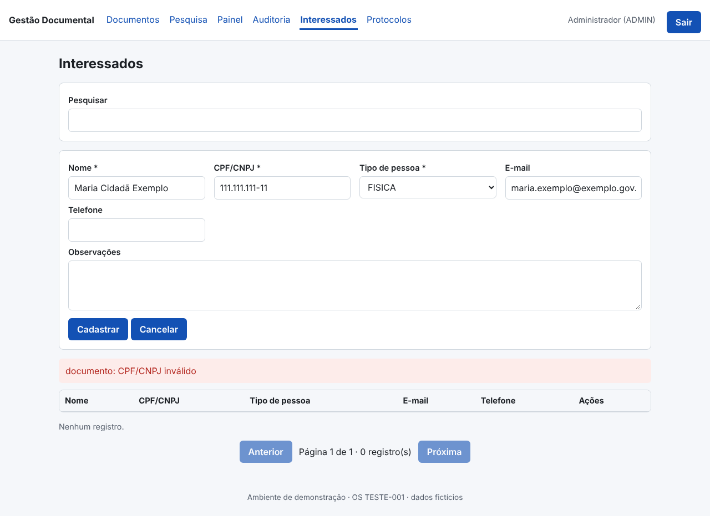
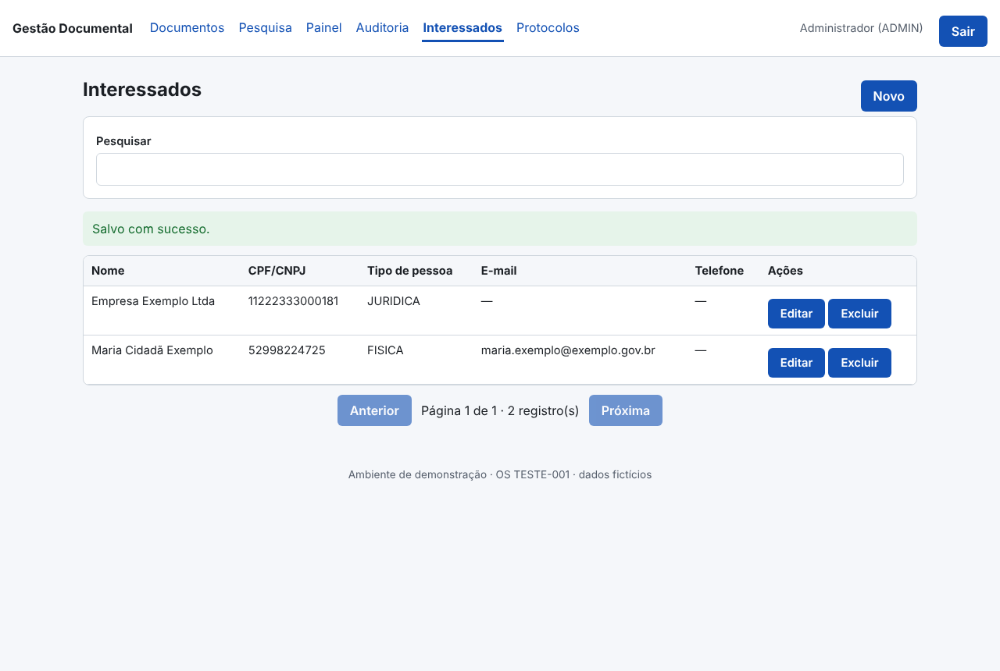
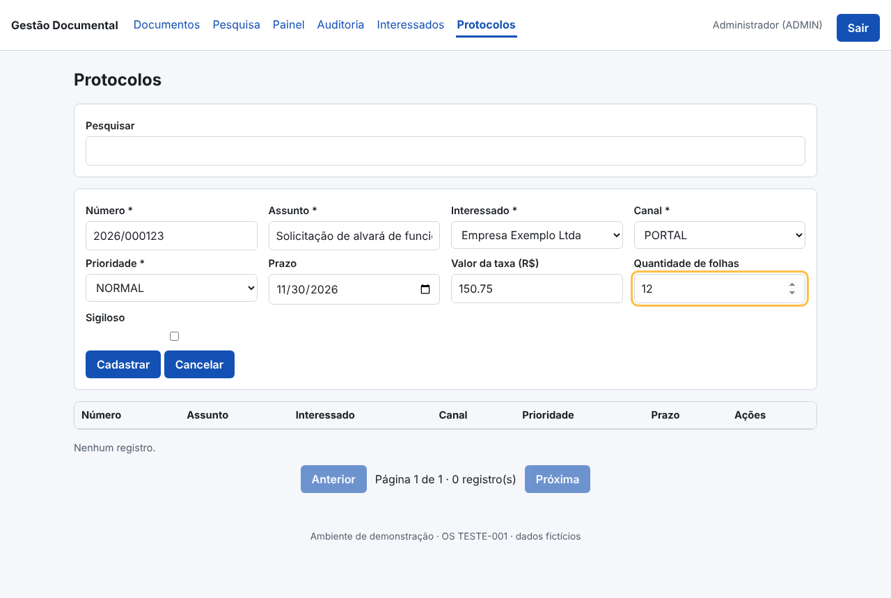
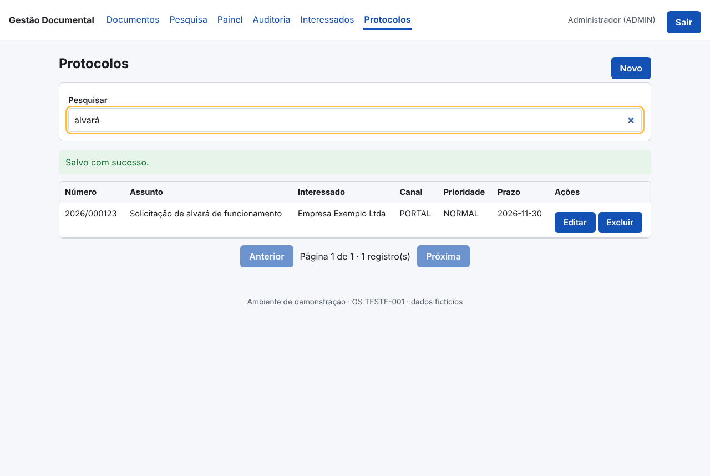

# Relatório Técnico de Execução e Medição — novembro de 2026

## 1. Situação do contrato

O ciclo é: **a empresa executa → o órgão confere e aceita → o órgão paga**. Cada etapa só avança quando a anterior tem registro.

| Etapa | UST | Valor | Situação |
|---|---|---|---|
| Contratado | 300 | — | total do contrato |
| Executado | 80,4 | R$ 7.800,00 | entregue, testado e auditado; vai para o aceite do órgão |
| Aceito pelo órgão | 0 | — | próxima etapa: o órgão confere o executado e emite o termo de aceite |
| Pago | 0 | — | depois do aceite (registre em PAGAMENTOS.csv) |
| **Saldo para executar** | **219,6** | | contratado − executado |
| ↳ já planejado | 29,4 | | 2 módulo(s) com data (seção 10) |
| ↳ ainda sem planejamento | 190,2 | | precisa de novas demandas/OS do órgão |

Em uma frase: de 300 UST contratadas, 80,4 já foram executadas (26,8%); 29,4 estão planejadas e 190,2 ainda não têm demanda.
> OS-TESTE-002: UST FICTÍCIAS — catálogo, perfis e valores de demonstração; sem valor para faturamento.

## 2. Meta diária

- **Meta de hoje (06/11/2026):** 10,9 UST — módulos previstos para hoje: MOD-102.
- **Executado hoje:** 0 UST.
- **Ritmo para executar todo o saldo até o fim da vigência (31/03/2027):** 2,1 UST por dia útil (104 dias úteis).

Como a meta é calculada: a UST de cada módulo do planejamento é dividida igualmente pelos dias úteis entre a data de início e a de fim; a meta do dia é a soma dos módulos em andamento naquele dia. O executado entra no dia em que o módulo foi medido.

| Dia | Meta (UST) | Executado (UST) | Meta acumulada | Executado acumulado |
|---|---|---|---|---|
| 03/11 | 35,3 | 80,4 | 35,3 | 80,4 |
| 04/11 | 23,1 | 0 | 58,5 | 80,4 |
| 05/11 | 10,9 | 0 | 69,4 | 80,4 |
| 06/11 (hoje) | 10,9 | 0 | 80,4 | 80,4 |
| 09/11 | 4,9 | a executar | 85,3 | — |
| 10/11 | 9,8 | a executar | 95,1 | — |
| 11/11 | 9,8 | a executar | 104,9 | — |
| 12/11 | 4,9 | a executar | 109,8 | — |

## 3. Identificação

| Campo | Informação |
|---|---|
| Órgão | Órgão Fictício de Demonstração |
| Contrato | TESTE-002 |
| Objeto | Atendimento ao cidadão e protocolo (demonstração da fábrica — FICTÍCIO) |
| Ordens de serviço | OS-TESTE-002 — Projeto ATENDIMENTO — interessados e protocolos |
| Sistema(s) | projetos/gestao-documental |
| Período | novembro de 2026 (até 06/11/2026) |
| Contratada | V4 Tecnologia Brasil · DigitalGov — CNPJ 24.361.188/0001-61 |
| Responsável técnico | Warley Luciano Costa Gomes |

## 4. Equipe técnica e agentes de IA

Os agentes de IA executam as etapas técnicas; a equipe técnica responde por eles: orienta, revisa e aprova. Participação individual só aparece quando há registro (commit, revisão, ata ou registro do gestor).

| Nome | Função | Responsabilidade | Desde | Participações registradas |
|---|---|---|---|---|
| Arthur Miguel | Desenvolvedor pleno Java | Responde pela execução dos agentes de IA: orienta, revisa e aprova (designação do gestor em 06/11/2026) | 2026-11-06 | nenhuma ainda |
| Lucas | Desenvolvedor pleno Java | Responde pela execução dos agentes de IA: orienta, revisa e aprova (designação do gestor em 06/11/2026) | 2026-11-06 | nenhuma ainda |
| Jerlian | Desenvolvedor pleno Java | Responde pela execução dos agentes de IA: orienta, revisa e aprova (designação do gestor em 06/11/2026) | 2026-11-06 | nenhuma ainda |
| Warley | Desenvolvedor pleno Java | Responde pela execução dos agentes de IA: orienta, revisa e aprova (designação do gestor em 06/11/2026) | 2026-11-06 | nenhuma ainda |
| Will | Desenvolvedor pleno Java | Responde pela execução dos agentes de IA: orienta, revisa e aprova (designação do gestor em 06/11/2026) | 2026-11-06 | nenhuma ainda |

**Etapas da OS-TESTE-002 executadas pelos agentes:**

| Etapa | Agente (papel na fábrica) | Resultado | Data | Situação |
|---|---|---|---|---|
| Código (banco, API, telas, testes) | G06/G07/G08 + gerador de cadastros | commits no git (autor: Claude) | 2026-11-03 | concluído |
| Conferência da autorização | G03 Gestor Contratual | autorização registrada | 2026-11-03 | concluído |
| Execução dos testes | G12 Engenheiro de Testes | 140 verificações aprovadas | 2026-11-03 | concluído |
| Registro dos commits | G17 Auditor de Evidências | 5 commits | 2026-11-03 | concluído |
| Auditoria das evidências | G17 Auditor de Evidências | 3 módulos aprovados | 2026-11-03 | concluído |
| Medição | G15 Medidor de UST | previsto 80.4 · comprovado 80.4 · aceito 0 | 2026-11-03 | concluído |
| Relatórios | G19 Gerador de Relatórios | relatório diário e fechamento gerados | 2026-11-03 | concluído |
| Checklist de qualidade | G20 Homologador Técnico | 16 controle(s) crítico(s) aguardam verificação humana — verifique e rode de novo com --aprovado-por "Nome (cargo)" | 2026-11-03 | aguardando a equipe |
| Pacote de entrega | G20 Homologador Técnico | — | — | pendente |

## 5. O que foi feito e quanto foi medido

| Módulo | O que foi entregue | Item do contrato | UST executada | Testes |
|---|---|---|---|---|
| MOD-100 — Base modular para cadastros | API e regras de negócio, Banco de dados, Testes automatizados, Telas | SRV-BASE | 12,2 | 105 ok, 0 falha(s) |
| MOD-101 — Cadastro de interessados | API e regras de negócio, Banco de dados, Testes automatizados, Telas | SRV-CRUD-M | 24,4 | 17 ok, 0 falha(s) |
| MOD-102 — Cadastro de protocolos | API e regras de negócio, Banco de dados, Testes automatizados, Telas | SRV-CRUD-A | 43,8 | 18 ok, 0 falha(s) |
| **Total** | | | **80,4** | |

### MOD-100 — Base modular para cadastros

- **Banco de dados:** estrutura e acesso a dados — 1 arquivo(s), 32 linhas.
- **API (backend):** 2 rota(s): `GET /api/health`, `GET /api/health/db` — 4 arquivo(s), 190 linhas.
- **Telas (frontend):** App — 1 arquivo(s), 62 linhas.
- **Testes:** 105 executado(s), 0 falha(s) — APROVADO em 2026-11-03 (2 arquivo(s) de teste, 134 linhas).
- **Medição:** item SRV-BASE — SRV-BASE × 1 (Estrutura base de módulos (FICTÍCIO); Catálogo fictício item 1): previsto 12,2, executado **12,2**, aceito 0 UST; 10 h pelo catálogo.
- **Commits:** `ea7f8f4` 2026-11-03 MOD-100: base modular — descoberta automática de módulos, validadores CPF/CNPJ e permissão por perfil; `e4e16a3` 2026-11-03 MOD-007: infraestrutura (Docker Compose, Nginx/TLS, backup/restauração), base da API, migrações e documentação.
- **Responsável:** equipe técnica (Arthur Miguel, Lucas, Jerlian, Warley, Will); revisão individual deste módulo: sem registro.

### MOD-101 — Cadastro de interessados

- **Banco de dados:** tabela(s) `interessados` — 2 arquivo(s), 59 linhas.
- **API (backend):** 5 rota(s): `GET /api/interessados`, `GET /api/interessados/{rid}`, `POST /api/interessados`, `PATCH /api/interessados/{rid}`, `DELETE /api/interessados/{rid}` — 3 arquivo(s), 198 linhas.
- **Telas (frontend):** InteressadoPagina — 2 arquivo(s), 124 linhas.
- **Testes:** 17 executado(s), 0 falha(s) — APROVADO em 2026-11-03 (2 arquivo(s) de teste, 149 linhas).
- **Medição:** item SRV-CRUD-M — SRV-CRUD-M × 1 (Cadastro completo média complexidade (FICTÍCIO); Catálogo fictício item 2): previsto 24,4, executado **24,4**, aceito 0 UST; 24 h pelo catálogo.
- **Commits:** `83e7978` 2026-11-03 MOD-101: cadastro de interessados (gerado da especificação: modelo, migração, API, auditoria, tela e testes).
- **Responsável:** equipe técnica (Arthur Miguel, Lucas, Jerlian, Warley, Will); revisão individual deste módulo: sem registro.

### MOD-102 — Cadastro de protocolos

- **Banco de dados:** tabela(s) `protocolos` — 2 arquivo(s), 66 linhas.
- **API (backend):** 5 rota(s): `GET /api/protocolos`, `GET /api/protocolos/{rid}`, `POST /api/protocolos`, `PATCH /api/protocolos/{rid}`, `DELETE /api/protocolos/{rid}` — 3 arquivo(s), 197 linhas.
- **Telas (frontend):** ProtocoloPagina — 2 arquivo(s), 131 linhas.
- **Testes:** 18 executado(s), 0 falha(s) — APROVADO em 2026-11-03 (2 arquivo(s) de teste, 161 linhas).
- **Medição:** item SRV-CRUD-A — SRV-CRUD-A × 1 (Cadastro completo alta complexidade com relacionamentos (FICTÍCIO); Catálogo fictício item 3): previsto 43,8, executado **43,8**, aceito 0 UST; 36 h pelo catálogo.
- **Commits:** `6e7928a` 2026-11-03 MOD-102: lista mostra o nome do interessado; mensagens de validação sem prefixo técnico (gerador corrigido); `7313248` 2026-11-03 MOD-102: cadastro de protocolos com relacionamento a interessados (gerado da especificação).
- **Responsável:** equipe técnica (Arthur Miguel, Lucas, Jerlian, Warley, Will); revisão individual deste módulo: sem registro.

## 6. De onde vêm os números (memória de cálculo)

1. **O contrato define o catálogo de serviços** (`CATALOGO_SERVICOS.csv`): para cada serviço, quantas horas de cada perfil ele consome.
2. **Cada perfil tem um fator de UST por hora e um valor por hora** (`PERFIS.csv`).
3. **A fórmula do contrato é `HORAS_X_FATOR`**: UST do serviço = soma de (horas do perfil × fator do perfil).
4. **A OS diz quais serviços cada módulo usa.**
5. **O módulo só conta como executado** quando o código está no git, os testes passaram e a auditoria das evidências aprovou. Linhas de código não entram na conta.

| Módulo | Serviço | Conta | UST | Valor |
|---|---|---|---|---|
| MOD-100 | SRV-BASE | 8 h Desenvolvedor sênior × 1,3 + 2 h Analista de testes × 0,9 | 12,2 | R$ 1.210,00 |
| MOD-101 | SRV-CRUD-M | 4 h Analista de requisitos × 1,2 + 16 h Desenvolvedor pleno × 1 + 4 h Analista de testes × 0,9 | 24,4 | R$ 2.300,00 |
| MOD-102 | SRV-CRUD-A | 6 h Analista de requisitos × 1,2 + 24 h Desenvolvedor sênior × 1,3 + 6 h Analista de testes × 0,9 | 43,8 | R$ 4.290,00 |

Exemplo de leitura: "4 h Analista × 1,2" significa 4 horas do perfil Analista, que valem 1,2 UST por hora = 4,8 UST.

## 7. Tecnologias utilizadas

| Camada | Tecnologias | Fonte |
|---|---|---|
| Exigidas no contrato | React, FastAPI, PostgreSQL | `contrato.yaml` |
| Banco de dados | PostgreSQL 16 | `contrato.yaml` |
| Backend (Python) | fastapi, uvicorn, sqlalchemy, alembic, psycopg2-binary, pydantic, python-multipart, bcrypt, pyjwt | `projetos/gestao-documental/backend/requirements.txt` |
| Frontend (TypeScript/React) | react, react-dom, react-router-dom | `projetos/gestao-documental/frontend/package.json` |
| Build e testes de tela | @testing-library/dom, @testing-library/react, @testing-library/user-event, @types/node, @types/react, @types/react-dom, @vitejs/plugin-react, jsdom, typescript, vite, vitest | `projetos/gestao-documental/frontend/package.json` |
| Infraestrutura (contêineres) | nginx:1.27-alpine | `projetos/gestao-documental/docker-compose.prod.yml` |
| Infraestrutura (contêineres) | postgres:16-alpine | `projetos/gestao-documental/docker-compose.yml` |

## 8. Código de novembro de 2026

**projetos/gestao-documental:** 11 commit(s), +4832 / −3 linhas.

| Camada | Arquivos alterados | Linhas adicionadas | Linhas removidas |
|---|---|---|---|
| API e regras de negócio (backend) | 31 | 1479 | 0 |
| Telas (frontend) | 29 | 1129 | 2 |
| Testes automatizados | 22 | 1050 | 1 |
| Banco de dados | 13 | 540 | 0 |
| Infraestrutura (Docker, proxy, CI) | 12 | 309 | 0 |
| Documentação | 6 | 276 | 0 |
| Especificação | 2 | 27 | 0 |
| Outros | 2 | 22 | 0 |

| Commit | Data | Descrição |
|---|---|---|
| `6e7928a` | 2026-11-03 | MOD-102: lista mostra o nome do interessado; mensagens de validação sem prefixo técnico (gerador corrigido) |
| `7313248` | 2026-11-03 | MOD-102: cadastro de protocolos com relacionamento a interessados (gerado da especificação) |
| `83e7978` | 2026-11-03 | MOD-101: cadastro de interessados (gerado da especificação: modelo, migração, API, auditoria, tela e testes) |
| `ea7f8f4` | 2026-11-03 | MOD-100: base modular — descoberta automática de módulos, validadores CPF/CNPJ e permissão por perfil |
| `e10e719` | 2026-11-03 | MOD-006: trilha de auditoria somente inserção e tela de consulta |
| `3cbdf19` | 2026-11-03 | MOD-005: painel administrativo com indicadores e gestão de usuários |
| `0ca859e` | 2026-11-03 | MOD-004: pesquisa por termos e filtros respeitando classificação |
| `348ec80` | 2026-11-03 | MOD-003: upload de PDF com validação de assinatura, limite e SHA-256 |
| `e419dae` | 2026-11-03 | MOD-002: cadastro documental com classificação LAI e arquivamento lógico |
| `0c1c851` | 2026-11-03 | MOD-001: autenticação, logout, recuperação de senha, perfis e permissões |
| `e4e16a3` | 2026-11-03 | MOD-007: infraestrutura (Docker Compose, Nginx/TLS, backup/restauração), base da API, migrações e documentação |

### Código de hoje (06/11/2026)

**projetos/gestao-documental:** 0 commit(s), +0 / −0 linhas.

## 9. Código total do sistema

**projetos/gestao-documental:** 110 arquivo(s), 4829 linhas, 11 commit(s) desde o início.

| Camada | Arquivos | Linhas |
|---|---|---|
| API e regras de negócio (backend) | 29 | 1479 |
| Telas (frontend) | 26 | 1127 |
| Testes automatizados | 21 | 1049 |
| Banco de dados | 12 | 540 |
| Infraestrutura (Docker, proxy, CI) | 12 | 309 |
| Documentação | 6 | 276 |
| Especificação | 2 | 27 |
| Outros | 2 | 22 |

| Linguagem | Arquivos | Linhas |
|---|---|---|
| Python | 48 | 2765 |
| TypeScript (React) | 26 | 1056 |
| Markdown | 6 | 276 |
| TypeScript | 5 | 183 |
| Configuração | 5 | 163 |
| YAML | 4 | 98 |
| Shell | 3 | 70 |
| CSS | 1 | 57 |
| Outros | 5 | 53 |
| JSON | 2 | 49 |
| Docker | 2 | 34 |
| HTML | 1 | 13 |
| Texto | 2 | 12 |

> Linhas de código e commits mostram o tamanho do trabalho; a quantidade medida vem do catálogo do contrato, não das linhas.

## 10. A fazer (planejado)

| Módulo | O que fazer | Item do contrato | UST (estimativa) | Início | Fim | Responsável |
|---|---|---|---|---|---|---|
| MOD-201 | Relatório de protocolos por período | SRV-REL | 14,7 | 2026-11-09 | 2026-11-11 | a definir |
| MOD-202 | Relatório de atendimento por canal | SRV-REL | 14,7 | 2026-11-10 | 2026-11-12 | a definir |

Total planejado: 29,4 UST (estimativa pelo catálogo; vira executado quando entregue e medido).

## 11. Próximas etapas e pendências

- Próxima etapa normal: enviar ao órgão os 80,4 UST executados para conferência e termo de aceite.
- OS-TESTE-002: a equipe técnica verifica o checklist — 16 controle(s) crítico(s) aguardam verificação humana — verifique e rode de novo com --aprovado-por "Nome (cargo)".
- Registrar a revisão de cada módulo por um membro da equipe (MOD-100, MOD-101, MOD-102) em PARTICIPACOES.csv (data, pessoa, módulo, tipo REVISAO/APROVACAO, evidência).

## 12. Arquivos de origem

- UST: `medicoes/<OS>.json` (medição pelo catálogo do contrato) e `contrato.yaml`.
- O que foi feito, código e commits: repositório git (`git log`, `git ls-files`).
- Testes: `evidencias/<OS>/<MÓDULO>/TESTES.json` (execuções reais com JUnit).
- Telas: capturas reais em `evidencias/<OS>/<MÓDULO>/SCREENSHOTS/`.
- A fazer e meta diária: `PLANEJAMENTO.csv` (estimativa pelo catálogo, datas de início e fim).
- Pagamentos: `PAGAMENTOS.csv` (data, competência, UST, valor e documento do pagamento).

