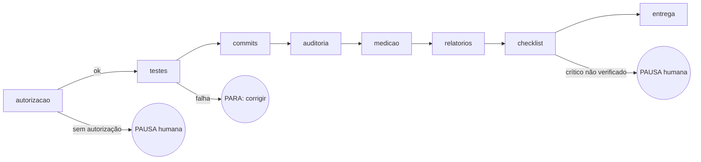

# Conceitos do LangGraph aplicados à fábrica

Fonte: README e documentação do LangGraph (MIT, LangChain Inc.). Não usamos a biblioteca; aplicamos as ideias na CLI.

| Conceito | Na fábrica |
|---|---|
| **Grafo de estados (StateGraph):** nós e arestas | `fabrica.py fluxo`: autorização → testes → commits → auditoria → medição → relatórios → checklist → entrega |
| **Execução durável (checkpoint):** retoma de onde parou | o estado de cada nó fica em `contratos/<ID>/fluxos/<OS>.json`; `--retomar` continua do primeiro nó não concluído |
| **Humano no circuito (interrupt):** pausa para aprovação | o fluxo **pausa** quando falta autorização da OS ou quando o checklist exige verificação humana; registra o motivo |
| **Memória de longo prazo** | quadro de tarefas, decisões, handoffs, bloqueios (`fabrica/comunicacao/`) e evidências versionadas |
| **Observabilidade** | cada nó grava início, fim, resultado e erro; relatórios diários mostram o histórico |

