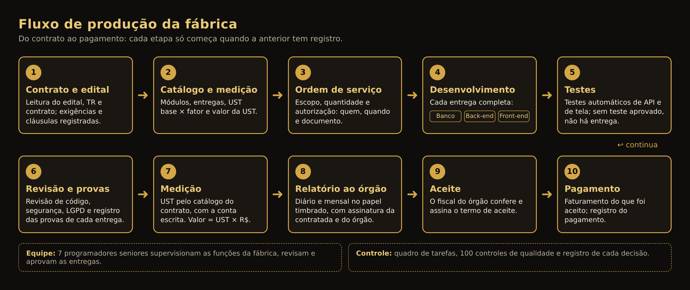

# Modelo da Fábrica de Software — DigitalGov

A fábrica executa contratos públicos de tecnologia: lê o edital, planeja, desenvolve os sistemas, testa, mede a produção pelo catálogo do contrato e entrega ao órgão os relatórios para conferência, aceite e pagamento. Este documento mostra como ela está organizada e como trabalha hoje.

## 1. Como a fábrica trabalha

Regra geral: cada etapa só começa quando a anterior tem registro. Sem ordem de serviço autorizada, nada é executado. Sem teste aprovado, não há entrega. Sem entrega completa, não há medição. Sem termo do órgão, nada é considerado aceito.

## 2. Estrutura: 8 áreas e 44 funções

Cada função tem um profissional responsável, que supervisiona, revisa e aprova o trabalho. A designação de cada pessoa fica registrada no documento de participação da equipe.

| Área | Funções | O que faz | Perfil responsável |
|---|---|---|---|
| Gestão do contrato | 8 | Edital e TR, gestão contratual, plano de execução (GEC), habilitação, custos, SLA e glosas, cronograma e capacidade | Gerência |
| Arquitetura e liderança técnica | 7 | Arquitetura, divisão em tarefas, distribuição do trabalho, integração e acompanhamento das sprints | Programador Sênior |
| Banco de dados | 2 | Modelagem, migrações com reversão, índices, integridade, backup | Programador Sênior — Banco de dados |
| Back-end | 6 | APIs, regras de negócio, validação, permissões por perfil, integrações | Programador Sênior — Back-end |
| Front-end | 4 | Telas, formulários, painéis, acessibilidade | Programador Sênior — Front-end |
| Qualidade e testes | 6 | Testes automáticos de API e de tela, revisão de código, homologação técnica | Programador Sênior — Testes |
| Segurança e infraestrutura | 4 | LGPD, segredos, auditoria, ambientes, publicação e recuperação | Programador Sênior — Back-end |
| Medição, provas e relatórios | 7 | Medição em UST e pontos de função, conferência das provas, participação da equipe, relatórios | Gerência |
| **Total** | **44** | | |

## 3. Equipe

| Código | Profissional | Função |
|---|---|---|
| P01 | Jerlian | Programador Sênior |
| P02 | Ruan | Programador Sênior |
| P03 | Arthur Miguel | Programador Sênior |
| P04 | Warley | Programador Sênior |
| P05 | Werverton | Programador Sênior |
| P06 | João Miguel | Programador Sênior |
| P07 | Warley C. | Programador Sênior |

Perfis usados nos relatórios: Programador Sênior — Banco de dados, Back-end, Front-end e Testes. As horas de cada perfil são preenchidas pela contratada no documento de participação; a medição é feita em UST pelo catálogo do contrato.

## 4. Como cada entrega é feita

Uma entrega só está pronta quando tem as três camadas funcionando e testadas:

| Camada | O que é entregue | Como é provado |
|---|---|---|
| Banco de dados | Tabelas e migrações numeradas, cada uma com o caminho de volta | Migração aplicada e desfeita num banco vazio |
| Back-end | Rotas da API com validação, permissão por perfil e registro na auditoria | Testes automáticos da API |
| Front-end | Telas e formulários ligados à API, acessíveis | Teste de tela no navegador e capturas |

Fluxo de cada módulo, em 15 passos: requisitos, arquitetura, tarefas, distribuição, código, integração, testes, correções, revisão de código, segurança, versionamento, documentação, prévia, provas e aprovação.

Tecnologias: a fábrica tem 9 perfis de linguagem prontos (Python/FastAPI, TypeScript/Node, React, Java/Spring, C#/.NET, PHP, Go, Rust e o padrão governamental). Quando o edital não exige outra, usa Python/FastAPI com PostgreSQL no back-end e React no front-end.

## 5. Como a fábrica mede

| Etapa | Regra |
|---|---|
| Catálogo | Cada módulo do contrato vale UST base × fator de complexidade (1, 2 ou 3) |
| Entregas | O módulo é dividido nas entregas que o TR descreve; cada entrega vale o total do módulo ÷ número de entregas |
| Executado | Entrega completa (banco, back-end e front-end), testada e com as provas conferidas |
| Aceito | Somente com termo de aceite do órgão |
| Pago | Somente com o pagamento registrado |
| Valor | UST × valor unitário do contrato |

Exemplo do contrato de comunicação: o módulo M01 vale 270 UST base × fator 3 = 810 UST e tem 4 entregas, então cada entrega vale 202,5 UST. O controle de sessão foi entregue: 202,5 UST × R$ 30,00 = R$ 6.075,00. Para receber o M01 inteiro, as 4 entregas precisam ser feitas.

A fábrica recusa o relatório se a quantidade de um item não bater com o catálogo. Horas não viram UST sem fórmula escrita no contrato, e linhas de código não são usadas como medida.

## 6. Documentos que a fábrica produz

| Documento | Quando | Para quem |
|---|---|---|
| Abertura do dia | Início do dia | Gerência |
| Relatório diário | Fim do dia | Gerência |
| Fechamento do dia | Fim do dia | Gerência |
| Relatório de medição ao órgão — diário | Cada dia com entrega | Órgão (assinatura da contratada e do órgão) |
| Relatório de medição ao órgão — mensal | Fechamento do mês | Órgão (assinatura da contratada e do órgão) |
| Plano de Gestão da Execução Contratual (GEC) | Início do contrato | Órgão e gerência |
| Planejamento de Projeto (PPJ) | Quando o edital pede | Órgão |
| Confronto com o edital | Ao receber o edital | Gerência |
| Documento de participação da equipe | A cada período | Gerência |
| Pacote de entrega (código, banco, manuais, manifesto) | Fim de cada OS | Órgão |
| Painel de produção | Atualizado a cada medição | Gerência |

Todos os documentos saem em Word e PDF no papel timbrado.

## 7. Controles

- Quadro de tarefas com estados (a fazer, em andamento, em revisão, em teste, concluído) e registro de cada mudança.
- 100 controles de qualidade em 10 grupos: contrato e requisitos, arquitetura, código-fonte, banco de dados, segurança e LGPD, testes, desempenho, infraestrutura, provas e medição, documentação e homologação.
- Registro das decisões, das passagens de trabalho e dos bloqueios.

O que a fábrica nunca faz sem autorização registrada:

- executar ordem de serviço sem saber quem autorizou, quando e em qual documento;
- publicar em produção;
- enviar documentos ou mensagens ao órgão;
- assinar, declarar aceite ou atestar participação de pessoas;
- alterar quantidades medidas sem trabalho comprovado;
- guardar CPF ou senhas no repositório.

## 8. Contratos e sistemas na fábrica

| Contrato | Objeto | Situação |
|---|---|---|
| FIC-COM-2026-001 | Plataforma Integrada de Comunicação Institucional e Atendimento Digital (18 módulos) | Em execução: OS-FIC-002 entregue e medida |
| PE-223-2026-PR | Pregão Eletrônico 223/2026 — Estado do Paraná (15 serviços) | Edital analisado; aguardando planejamento e OS |
| TESTE-001 e TESTE-002 | Contratos internos de validação da fábrica | Pacote de entrega gerado (uso interno) |

Sistemas com código na fábrica: Plataforma de Comunicação Institucional, Atendimento ao Cidadão, Gestão Documental e o laboratório de 15 serviços de demonstração do edital do Paraná.

## 9. Situação do contrato FIC-COM-2026-001

| Item | Quantidade |
|---|---|
| Contratado | 12.000 UST |
| Executado | 202,5 UST (R$ 6.075,00) |
| Aceito pelo órgão | 0 UST |
| Pago | 0 UST |
| Saldo a executar | 11.797,5 UST |
| Módulos do contrato | 18 módulos, 84 entregas |
| Testes automáticos da plataforma | 26 aprovados |

## 10. Próximos passos

1. Receber do órgão o número do contrato, o nome do responsável e a ordem de serviço assinada.
2. Preencher o documento de participação: quem fez cada entrega e as horas.
3. Enviar ao órgão o relatório de medição de novembro para conferência e aceite.
4. Abrir a próxima ordem de serviço. Sugestão: módulo M18 (integração contínua, ambientes, backup e restauração), que vale 1.320 UST e não depende de terceiros.
