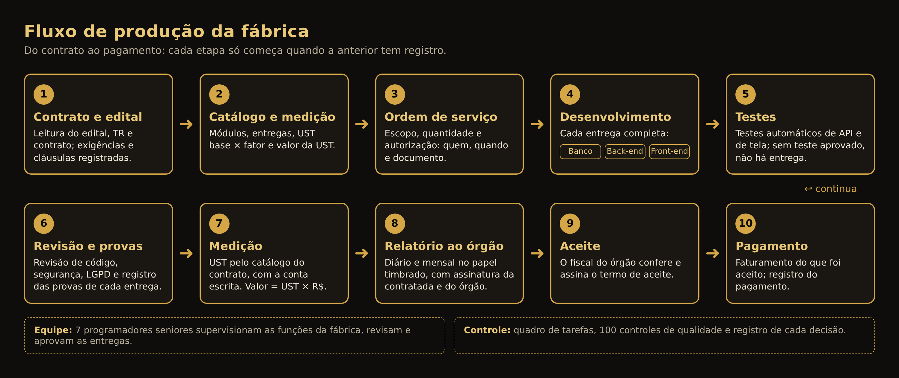

# Treinamento: Como montar e operar uma Fábrica de Software para Contratos Públicos

Curso prático para equipes de outras fábricas. Ensina o método que usamos para executar contratos públicos de TI: do edital à medição aceita pelo órgão, com código testado, provas e relatórios que resistem a uma fiscalização.

| Item | Descrição |
|---|---|
| Público | Gerentes de contrato, líderes técnicos, programadores, analistas de qualidade e quem prepara a medição |
| Carga horária | 16 horas (2 dias de 8 horas), sendo metade em prática |
| Pré-requisitos | Noções de git, de banco de dados relacional e de leitura de edital/termo de referência |
| Material | Esta apostila, o modelo da fábrica (`fabrica/docs/MODELO_DA_FABRICA`), os manuais do Gerenciador Central e um contrato fictício para os exercícios |
| Avaliação | Exercícios práticos e prova de 15 questões (gabarito no Anexo C). Aprovação: 11 acertos e todos os exercícios entregues |

Todos os exemplos usam dados fictícios. Nenhum nome de órgão, servidor ou profissional real aparece nos exercícios.

## Como usar esta apostila

Cada módulo tem: **objetivo**, **conteúdo**, **o que aprendemos na prática** (erros reais que cometemos e como corrigimos) e **exercício**. Leia o conteúdo, faça o exercício e só então passe ao próximo módulo. Os comandos indicados existem e foram executados na nossa fábrica; quando um comando depender do seu ambiente, isso está dito.

## Programa do curso

| Dia | Período | Módulos |
|---|---|---|
| 1 | Manhã | 1. Como a fábrica funciona · 2. Do edital ao plano · 3. Ordem de serviço e autorização |
| 1 | Tarde | 4. Engenharia: a entrega completa · 5. Medição |
| 2 | Manhã | 6. Horas e equipe · 7. Relatórios ao órgão · 8. Gerenciador Central |
| 2 | Tarde | 9. Segurança e LGPD · 10. Várias equipes no mesmo repositório · 11. Lições aprendidas · prova |

## Módulo 1 — Como a fábrica funciona

**Objetivo:** entender o fluxo de produção e as regras que nunca se quebram.



### 1.1 O fluxo

Edital → plano → ordem de serviço autorizada → desenvolvimento → testes → provas → medição → relatório ao órgão → aceite → pagamento.

Cada etapa só começa quando a anterior tem **registro**. Sem OS autorizada, nada é executado. Sem teste aprovado, não há entrega. Sem entrega completa, não há medição. Sem documento do órgão, nada é aceito.

### 1.2 Os cinco estados de qualquer trabalho

| Estado | Significa | Quem pode declarar |
|---|---|---|
| PLANEJADO | Está no plano, nada foi feito | Responsável pelo planejamento |
| INICIADO | Há tarefa em andamento | Quadro de tarefas |
| EXECUTADO | Código pronto, no git | Histórico do git |
| VERIFICADO (comprovado) | Testes reais passaram e as provas estão completas | Execução dos testes + auditoria das provas |
| ACEITO | O órgão recebeu | Somente um documento do órgão (termo, ofício, e-mail do fiscal) |

Aprovação técnica interna **não é** aceite do órgão. Sem documento do órgão, a quantidade fica COMPROVADA, nunca ACEITA.

### 1.3 Funções e pessoas

Organizamos o trabalho em 44 funções agrupadas em 8 áreas (gestão do contrato, arquitetura, banco de dados, back-end, front-end, qualidade, segurança e infraestrutura, medição e relatórios). **Toda função tem um profissional responsável** que supervisiona, revisa e aprova. A designação de cada pessoa fica registrada no documento de participação da equipe.

### 1.4 As regras de ouro

1. **Nada inventado.** Commits vêm do git; testes, de execuções reais; horas, revisões, aprovações e aceites, só de registros feitos por pessoas. Sem registro = "sem registro".
2. **UST ≠ PF ≠ horas.** Uma unidade só vira outra se houver fórmula escrita no contrato.
3. **Autorização antes de executar** e autorização humana antes de publicar em produção.
4. **Evidência antes de afirmação:** antes de dizer "pronto", "passou" ou "corrigido", rode o comando que prova e leia a saída.
5. **Segredos e dados pessoais fora do repositório.**
6. **O edital manda.** Quando o edital pede diferente do nosso padrão, o padrão se adapta.

**Exercício 1.** Classifique cada frase como PLANEJADO, EXECUTADO, VERIFICADO ou ACEITO e diga qual prova falta para o próximo estado: (a) "O módulo de cadastro está no git, mas ninguém rodou os testes." (b) "O fiscal respondeu por e-mail: recebido o módulo de cadastro." (c) "Os 12 testes passaram e as provas estão na pasta da OS." (d) "Vamos fazer o relatório gerencial em dezembro."

## Módulo 2 — Do edital ao plano

**Objetivo:** extrair do edital tudo o que governa a execução, antes de escrever uma linha de código.

### 2.1 O que tirar do edital e do termo de referência

| Item | Por que importa |
|---|---|
| Objeto e serviços (catálogo) | Define o que pode ser medido |
| Unidade de medição (UST, PF, horas) e fórmula | Define como se mede; nunca invente fator |
| Valor unitário | Define o valor de cada entrega |
| Equipe exigida (perfis, certificações) | Será confrontada com a equipe cadastrada |
| Tecnologias exigidas | Define a stack |
| Níveis de serviço (SLA) e glosas | Define prazos e penalidades |
| Relatórios e documentos exigidos | Define títulos, seções e periodicidade dos relatórios |
| Critério de aceite | Define o que o órgão precisa assinar |

Cite sempre **cláusula e página**. Conflito entre documentos (edital diz uma coisa, contrato diz outra) vai para análise humana; a fábrica não escolhe sozinha.

### 2.2 Onde isso fica

Cada contrato tem uma pasta `contratos/<ID>/`. As exigências do edital ficam em `contratos/<ID>/EDITAL.yaml`; os geradores de relatórios e planos leem esse arquivo. Depois de preencher:

```bash
python3 fabrica/ferramentas/fabrica.py contrato novo CT-EXEMPLO-001
python3 fabrica/ferramentas/fabrica.py contrato faltantes CT-EXEMPLO-001
python3 fabrica/ferramentas/fabrica.py edital confrontar CT-EXEMPLO-001
```

O confronto diz o que a empresa já atende, o que precisa ajustar e o que falta.

### 2.3 O plano é do responsável

Quem define projetos, módulos, datas e responsáveis é o gestor do contrato. A fábrica calcula (quantidades, capacidade, saldo, prazos) e alerta; não decide a prioridade do órgão.

### O que aprendemos na prática

- Recebemos um pacote de contrato sem o número do contrato e sem o nome do responsável do órgão. Deixamos os campos **em branco e sinalizados**, em vez de preencher com algo plausível. Um relatório com número de contrato inventado é pior do que um relatório com o campo pendente.
- O catálogo que montamos a partir do TR foi registrado como **proposta da contratada**, pendente de ratificação pelo órgão. Essa ressalva aparece na medição até o órgão confirmar.

**Exercício 2.** No edital fictício do Anexo B, encontre: a unidade de medição, o valor unitário, os perfis exigidos e o critério de aceite. Para cada um, indique a cláusula.

## Módulo 3 — Ordem de serviço e autorização

**Objetivo:** nunca executar trabalho sem saber quem autorizou, quando e em que documento.

### 3.1 A OS em arquivo

Cada OS é um arquivo YAML em `contratos/<ID>/os/`. O bloco de autorização é obrigatório:

```yaml
os: OS-001
contrato: CT-EXEMPLO-001
titulo: Cadastro de cidadãos
autorizacao:
  autorizado: true
  autorizado_por: "Nome e cargo de quem autorizou"
  data: "2026-11-21"
  documento: "Ofício nº ... / OS assinada / e-mail do fiscal de dd/mm"
modulos:
  - id: MOD-001
    nome: Cadastro de cidadãos (item 1 de 3 do serviço S01)
    item_tabela: CAT-S01-01
    ust_previsto: 40
```

Sem `autorizado: true`, `autorizado_por` e `data`, a ferramenta recusa a execução.

### 3.2 Autorização interna × OS do órgão

Às vezes a contratada adianta trabalho com autorização interna. Isso é permitido, mas tem que ser escrito assim: "autorização interna da contratada; OS do órgão pendente". O controle de qualidade C003 ("OS autorizada por responsável do contratante") **continua pendente** até chegar a OS do órgão.

### O que aprendemos na prática

Executamos uma OS com autorização interna e registramos exatamente isso. Na conferência, o controle C003 apareceu como pendente de conferência humana, e não como aprovado. Foi o comportamento correto: a fábrica não transforma autorização interna em autorização do órgão.

**Exercício 3.** Escreva o bloco `autorizacao` de duas OS: uma autorizada por ofício do órgão e outra adiantada por decisão interna. Diga o que muda no relatório de cada uma.

## Módulo 4 — Engenharia: a entrega completa

**Objetivo:** entregar sempre as três camadas, testadas, com provas.

### 4.1 Uma entrega tem três camadas

| Camada | O que é entregue | Como se prova |
|---|---|---|
| Banco de dados | Tabelas e migrações numeradas, cada uma com caminho de volta | Migração aplicada e desfeita num banco vazio |
| Back-end | Rotas da API com validação, permissão por perfil e auditoria | Testes automáticos da API |
| Front-end | Telas e formulários ligados à API, acessíveis | Teste de tela no navegador e capturas |

Um cadastro completo é: tabela + migração + API validada + auditoria + permissão + tela + testes de API e de tela. A ferramenta gera esse conjunto a partir de uma especificação:

```bash
python3 fabrica/ferramentas/fabrica.py crud gerar <especificacao.yaml>
```

### 4.2 Os 15 passos de cada módulo

Requisitos → arquitetura → tarefas → distribuição → código → integração → testes → correções → revisão de código → segurança → commits → documentação → prévia → provas → aprovação humana.

### 4.3 Teste primeiro

Código novo nasce de um teste que falha (vermelho), recebe o mínimo para passar (verde) e depois é limpo (refatorar). Erro só se corrige depois de achar a causa raiz, e a correção vem com um teste que reproduz o erro.

### 4.4 Testes no banco real

Testes de cadastro rodam no **PostgreSQL de teste**, não em banco em memória. Use um banco de teste separado, apagado a cada teste, indicado por variável de ambiente (`TEST_DATABASE_URL`). Nunca aponte os testes para o banco real.

### 4.5 Um repositório por sistema e um banco por projeto

- Cada sistema nasce do modelo (`PROJETO.yaml`, stack declarada, CI).
- Cada projeto tem **banco e usuário próprios**. O usuário de um projeto não consegue entrar no banco de outro (`REVOKE CONNECT ... FROM PUBLIC`).

### 4.6 As provas de cada módulo

Pasta `contratos/<C>/evidencias/<OS>/<MOD>/`: escopo, requisitos, arquitetura, código alterado, commits, resultado dos testes (JUnit), logs, segurança, prévia, capturas de tela, revisões, responsáveis, medição, implantação e aceite.

```bash
python3 fabrica/ferramentas/fabrica.py auditar CT-EXEMPLO-001 OS-001
python3 fabrica/ferramentas/fabrica.py checklist CT-EXEMPLO-001 OS-001
```

### O que aprendemos na prática

- **Código "que funciona" não basta.** A primeira versão de uma plataforma passou nos testes, mas estava num arquivo único, difícil de revisar. Refatoramos em camadas (configuração, banco, migrações, segurança, esquemas de validação, controle de acesso, rotas por assunto). Os testes que já existiam garantiram que nada quebrou na refatoração.
- **Um painel com erro de sintaxe JavaScript passou despercebido** até alguém abrir no navegador. Desde então, toda tela é aberta num navegador automatizado e a ausência de erros no console faz parte da prova.
- **O checklist acusou 9 falhas críticas** porque o projeto não seguia o arranjo de pastas padrão. Em vez de mudar o checklist, criamos um mapeamento explícito (`caminhos_checklist` na OS) dizendo onde cada item está. Regra: adapte o caminho, nunca o critério.

**Exercício 4.** Escreva o teste (só o teste) de uma regra: "o CPF só pode ser gravado mascarado, no formato `***.456.789-**`". Rode e veja falhar antes de existir o código.

## Módulo 5 — Medição

**Objetivo:** medir só o que o contrato permite, com a conta explicada.

### 5.1 A regra

| Etapa | Regra |
|---|---|
| Catálogo | Cada serviço do contrato vale UST base × fator de complexidade |
| Entregas | O serviço é dividido nas entregas que o TR descreve; cada entrega vale o total do serviço ÷ número de entregas |
| Comprovado | Entrega completa (banco, back-end, front-end), testada e com provas |
| Aceito | Somente com documento do órgão |
| Pago | Somente com pagamento registrado |
| Valor | UST × valor unitário do contrato |

### 5.2 Exemplo resolvido

Um serviço vale 270 UST base × fator 3 = 810 UST. O TR descreve 4 entregas para ele. Cada entrega vale 810 ÷ 4 = 202,5 UST. Com valor unitário de R$ 30,00, uma entrega vale 202,5 × 30 = **R$ 6.075,00**. Para receber o serviço inteiro, as 4 entregas precisam ser feitas.

> **Se o catálogo diz 6 cadastros, entregue 6.** Quem conta é o catálogo do contrato, não o esforço. Cinco cadastros perfeitos não valem o item de seis.

### 5.3 Onde fica cada número

| Arquivo | Conteúdo |
|---|---|
| `TABELA_UST.csv` | Itens do contrato com UST por unidade e cláusula |
| `CATALOGO_ENTREGAS.csv` | Cada serviço dividido nas entregas do TR, com o que cada uma exige |
| `medicoes/<OS>.md` | Memória de cálculo da OS |

A ferramenta **recusa o relatório** se a quantidade de um item não bater com o catálogo.

```bash
python3 fabrica/ferramentas/fabrica.py medir CT-EXEMPLO-001 OS-001
python3 fabrica/ferramentas/fabrica.py saldo CT-EXEMPLO-001
python3 fabrica/ferramentas/fabrica.py oportunidades CT-EXEMPLO-001 OS-001
```

`oportunidades` mostra trabalho **já comprovado** que pode corresponder a itens do catálogo ainda não medidos. Aumentar a produção só com trabalho real: nunca com quantidade sem entrega, sem enquadramento no catálogo ou contada duas vezes.

### 5.4 O que nunca entra na medição

- Linhas de código (não comprovam quantidade faturável).
- Horas convertidas em UST sem fórmula no contrato.
- Trabalho que não pertence ao contrato (por exemplo, a importação inicial de um pacote recebido).

### O que aprendemos na prática

- **O commit de importação do pacote inicial foi contado como produção.** Corrigimos registrando no contrato os commits de linha de base (`tecnico.commits_linha_de_base`), que a medição exclui.
- **Medir de novo mudava a data em que a entrega foi comprovada.** A data de comprovação agora é gravada na primeira medição e não muda depois. Uma remedição não pode "rejuvenescer" uma entrega.
- **Itens da tabela saíam sem valor em reais.** A medição passou a calcular UST × valor unitário em todos os itens.
- **"202.5" em documento brasileiro** confunde o leitor. Quantidades e valores saem no formato brasileiro: 202,5 e R$ 6.075,00.

**Exercício 5.** Um serviço vale 120 UST base × fator 2 e o TR descreve 6 entregas. O valor unitário é R$ 28,00. Três entregas foram comprovadas; uma delas foi aceita pelo órgão. Calcule: UST por entrega, UST comprovadas, UST aceitas, valor comprovado e valor aceito.

## Módulo 6 — Horas e equipe

**Objetivo:** registrar o trabalho das pessoas sem inventar nada.

### 6.1 Horas são lançadas por pessoas

- As horas efetivamente trabalhadas são lançadas pelo profissional ou pelo gestor. O sistema **nunca** cria nem altera um lançamento.
- Não existe "8 horas para cada um" automático. Se o órgão exige registro de horas, cada pessoa lança as suas.
- O sistema aponta inconsistências para quem lançou corrigir: sobreposição de horários, horas acima da jornada, jornada excessiva, fim de semana, data futura e profissional inativo.

### 6.2 Três contas de horas, sempre separadas

| Conta | O que é |
|---|---|
| Horas de execução automatizada (agentes) | Tempo de processamento das ferramentas; não é hora de profissional |
| Horas humanas registradas | Lançadas pelas pessoas |
| Horas aceitas para faturamento | As que o gestor aceitou; depois de aceitas, ficam travadas |

Nos relatórios ao órgão, as horas por perfil aparecem **em branco para a contratada preencher**, com o nome do perfil (por exemplo, Programador Sênior — Banco de Dados, Back-end, Front-end, Testes).

### 6.3 Equipe e dados pessoais

- Cadastro mínimo: nome e função.
- CPF completo só na pasta privada do contrato (fora do git, permissão 600). Em tudo que é versionado ou enviado, só o CPF mascarado (`***.456.789-**`).
- Participação: o gestor marca quem conduziu, corrigiu, revisou, orientou e aprovou cada módulo.

```bash
python3 fabrica/ferramentas/fabrica.py participacao modelo CT-EXEMPLO-001
python3 fabrica/ferramentas/fabrica.py participacao importar ...
python3 fabrica/ferramentas/fabrica.py rateio ...
```

O **rateio é interno**: divide as UST do período entre quem tem participação registrada. Não altera a medição nem o aceite.

### O que aprendemos na prática

Já nos pediram para "colocar 8 horas para cada um e montar os registros". Recusamos: registro de horas que ninguém lançou é declaração falsa, e num contrato público isso é grave. A solução foi o documento de participação com as horas **em branco**, preenchido pelo gestor, e o Gerenciador Central com lançamento manual e alerta de inconsistências.

**Exercício 6.** Um profissional lançou 09h–13h e 12h–18h no mesmo dia. Quais inconsistências o sistema deve apontar? O que o sistema faz com o lançamento? Quem corrige?

## Módulo 7 — Relatórios ao órgão

**Objetivo:** produzir um relatório simples, que o fiscal entenda e assine.

### 7.1 O que o relatório ao órgão tem

1. Identificação do contrato, da OS e do período.
2. **Onde está cada UST:** item do catálogo, entrega, quantidade e valor.
3. **O que foi entregue em cada camada:** banco (tabelas e migrações), back-end (rotas), front-end (telas).
4. **A regra de medição** em uma frase ("cada entrega vale o total do serviço ÷ número de entregas; se o catálogo prevê 6 cadastros, são 6 entregas").
5. Perfis com horas **em branco** para a contratada preencher.
6. Duas assinaturas lado a lado: responsável da contratada e responsável do órgão.

```bash
python3 fabrica/ferramentas/fabrica.py relatorio orgao-diario CT-EXEMPLO-001 --data 2026-11-21
python3 fabrica/ferramentas/fabrica.py relatorio orgao-mensal CT-EXEMPLO-001 --data 2026-11-30
```

### 7.2 O que o relatório ao órgão não tem

- Linguagem de bastidor ("verificando", "a ferramenta conferiu", "o agente executou"). O órgão recebe o resultado, não o processo.
- Quantidade não comprovada.
- Dados pessoais completos.

As provas (commits, testes, capturas) seguem em anexo e em arquivo de dados separado, para quem quiser conferir.

### 7.3 Relatórios internos de cada dia

Abertura (contratado, saldo, plano do dia), relatório diário (o que foi produzido) e fechamento (quem trabalhou, produção, saldo). Todos em Word e PDF no papel timbrado da empresa.

```bash
python3 fabrica/ferramentas/fabrica.py abertura CT-EXEMPLO-001
python3 fabrica/ferramentas/fabrica.py relatorio diario CT-EXEMPLO-001
python3 fabrica/ferramentas/fabrica.py fechamento CT-EXEMPLO-001
```

### O que aprendemos na prática

- A primeira versão do relatório ao órgão parecia um relatório técnico interno: muita explicação de como a conferência foi feita. O cliente pediu "o básico e as assinaturas". Separamos: o documento ao órgão ficou curto; as provas foram para o anexo de dados.
- O cliente perguntou "onde você colocou as UST?". Desde então, toda UST do relatório aponta para o item do catálogo e para a entrega.
- **Linhas de tabela partidas entre páginas** confundem quem lê e assina. As linhas das tabelas não se dividem mais entre páginas.
- **Horário dos commits em UTC** fazia o trabalho de fim de tarde aparecer no dia seguinte. Os horários saem no fuso configurado da fábrica.

**Exercício 7.** Reescreva em linguagem de relatório ao órgão: "A ferramenta verificou automaticamente que os 12 testes passaram e o agente G15 mediu 40 UST." Resposta esperada no Anexo C.

## Módulo 8 — O Gerenciador Central

**Objetivo:** operar o sistema que reúne contratos, projetos, equipe, horas, medição e relatórios.

### 8.1 O que ele faz

| Área | Conteúdo |
|---|---|
| Cadastros | Órgãos, contratos, OS, editais e anexos, projetos, sistemas, profissionais, agentes, tarefas, testes, evidências |
| Horas | Lançamento manual, totais por dia e mês, inconsistências, aceite |
| Medição | UST, horas de serviço técnico e pontos de função por contrato; executado, aceito e saldo |
| Relatórios | Word, PDF e Excel |
| Projetos | Pasta, repositório, banco próprio, estado do código e dos testes |
| START | Prepara um projeto para trabalhar, passo a passo |

### 8.2 O botão START

O START confere, nesta ordem: projeto ativo → contrato vigente → OS autorizada → banco do projeto acessível → serviço do projeto no ar → aviso ao projeto (chamada autenticada com token). Se algum passo falha, ele para e diz qual.

Os agentes aparecem como **"Integração pendente"** enquanto não houver conector instalado. O sistema não simula execução que não aconteceu.

### 8.3 Instalação e primeiros passos

```bash
# Banco e migrações
cd projetos/digitalgov-gerenciador/backend
python3 -m alembic upgrade head
# Primeiro administrador (só com o banco vazio; senha digitada sem eco)
python3 -m app.bootstrap --login admin --nome "Administrador"
# Projeto novo com banco próprio, registrado no gerenciador
python3 -m app.cli projeto criar --codigo proj-exemplo --nome "Projeto Exemplo" --criar-banco --registrar
```

Manuais completos: instalação (Windows e Linux), banco de dados, novo projeto e implantação, na pasta `docs/` do gerenciador.

### 8.4 O que ele não faz

Não executa agentes sem conector, não altera horas lançadas, não aceita medição sozinho e não cria funcionalidades que o contrato não pede. Ele guarda o **nome da variável** onde está a senha de cada banco, nunca a senha.

### O que aprendemos na prática

- Uma referência circular entre tabelas (OS aponta para documento, documento aponta para OS) impediu a migração inicial. Resolvemos criando a segunda chave estrangeira depois das duas tabelas.
- Os scripts de backup liam o `.env` e **sobrescreviam** o banco informado na linha de comando. Agora o `.env` só é lido se o endereço não vier do ambiente. Um backup que aponta para o banco errado é pior do que nenhum backup.
- Todo backup sai com SHA-256; a restauração recusa arquivo alterado.

**Exercício 8.** Liste o que o START deve mostrar para um projeto cujo contrato está vigente, cuja OS não foi autorizada e cujo banco está acessível.

## Módulo 9 — Segurança e LGPD

**Objetivo:** proteger senhas, dados pessoais e acessos desde o primeiro commit.

| Tema | Prática |
|---|---|
| Segredos | `.env` fora do git; `.env.example` sem valores reais; arquivo de senha com permissão 600 |
| Senhas de usuários | Hash forte com sal (scrypt, argon2 ou bcrypt; o que o contrato exigir) |
| Sessões | Token aleatório; no banco, só o hash do token |
| Login | Bloqueio após 5 erros em 15 minutos; tudo registrado na auditoria |
| Perfis | Menor privilégio (por exemplo: administrador, gestor, consulta) e teste para cada recusa (403) |
| Auditoria | Antes e depois de cada alteração, quem e quando |
| Bancos | Um usuário por banco; conexão pública revogada |
| Telas | Política de segurança de conteúdo sem script embutido |
| Dados de demonstração | Sempre fictícios e identificados como tal |

### O que aprendemos na prática

- **Uma mensagem de erro mostrou uma senha.** Ao criar o banco de um projeto, o comando falhou e o rastro de erro exibiu a senha gerada. O usuário nunca chegou a ser criado e a senha foi descartada, mas a lição ficou: o comando agora valida a senha antes, desfaz o que criou se falhar, e as mensagens de erro são limpas antes de aparecer.
- **O registro de bloqueio de login se perdia** porque a transação era desfeita junto com o erro. Gravamos o registro antes de recusar o acesso. Teste: errar 5 vezes e conferir a auditoria.

**Exercício 9.** Revise o trecho abaixo e aponte três problemas:
`print(f"conectando em postgresql://app:{senha}@db/app"); usuarios = db.execute(f"select * from usuarios where login = '{login}'")`

## Módulo 10 — Várias equipes no mesmo repositório

**Objetivo:** trabalhar em paralelo sem apagar o trabalho dos outros.

- Toda atividade é uma tarefa no quadro, criada e movida pela ferramenta, reservando os arquivos que vai alterar:

```bash
python3 fabrica/ferramentas/fabrica.py tarefas criar --agente E05 --descricao "API do cadastro" --contrato CT-EXEMPLO-001 --os OS-001 --modulo MOD-001 --arquivo backend/app/rotas/cidadaos.py
python3 fabrica/ferramentas/fabrica.py tarefas mover <ID> IN_PROGRESS --por "Nome"
python3 fabrica/ferramentas/fabrica.py tarefas validar
```

- A ferramenta recusa: dependência não concluída, arquivo reservado por outra tarefa em andamento, bloqueio sem motivo e conclusão sem resultado ou prova.
- Duas pessoas no mesmo código: branches ou `git worktree` separados; a integração é feita pelo líder técnico.
- Antes de integrar, **leia o que a outra equipe mudou.** Em conflito, preserve as duas contribuições.

### O que aprendemos na prática

Duas sessões de trabalho criaram, em paralelo, telas diferentes para o mesmo painel e um README cada uma. Antes de integrar, lemos as mudanças da outra equipe. Mantivemos as telas mais completas, incorporamos o comando de primeiro administrador e as instruções de teste que a outra equipe escreveu, ajustamos o teste dela ao nome real do arquivo de estilo e rodamos todos os testes das duas antes de enviar. Nenhum trabalho foi descartado sem leitura.

**Exercício 10.** Duas tarefas reservam o mesmo arquivo. A primeira está IN_PROGRESS. O que acontece quando a segunda tenta passar para IN_PROGRESS? Qual é o caminho correto?

## Módulo 11 — Lições aprendidas (resumo)

| # | O que aconteceu | Causa | Correção | Como evitar |
|---|---|---|---|---|
| 1 | Painel com erro de JavaScript | Tela não aberta em navegador | Correção + teste no navegador | Toda tela é aberta e o console tem que estar limpo |
| 2 | 9 falhas críticas no checklist | Projeto fora do arranjo padrão | Mapeamento `caminhos_checklist` | Adaptar caminho, nunca critério |
| 3 | Linhas de comentário do planejamento lidas como dados | Leitura de CSV ingênua | Leitor único de tabelas | Uma função para ler tabelas, com teste |
| 4 | Commits no dia errado | Horário em UTC | Fuso configurado | Testar com commit perto da meia-noite |
| 5 | Importação do pacote medida como produção | Sem linha de base | Commits de linha de base excluídos | Registrar a linha de base no início do contrato |
| 6 | Data de comprovação mudava | Data recalculada a cada medição | Data gravada na primeira medição | Datas de fato são imutáveis |
| 7 | Itens sem valor em reais | Cálculo incompleto | UST × valor unitário em todos | Teste do valor total |
| 8 | Linhas de tabela partidas no Word | Padrão do gerador | Linhas não se dividem | Abrir o PDF antes de enviar |
| 9 | Relatório ao órgão confuso | Mistura de relatório interno e externo | Documento curto + anexo de provas | Um documento por leitor |
| 10 | "Onde estão as UST?" | Total sem detalhamento | Cada UST ligada a item e entrega | Memória de cálculo sempre visível |
| 11 | Pedido de 8 h automáticas | Pressão por registro | Horas em branco, lançadas por pessoas | Regra escrita: horas só de pessoas |
| 12 | Código difícil de revisar | Arquivo único | Refatoração em camadas, coberta por testes | Estrutura definida antes do código |
| 13 | Senha em rastro de erro | Erro sem tratamento | Validação, desfazer e mensagem limpa | Revisar caminhos de erro, não só o caminho feliz |
| 14 | Registro de bloqueio perdido | Transação desfeita | Gravar antes de recusar | Testar o que fica na auditoria depois do erro |
| 15 | Backup apontando para o banco errado | `.env` sobrescrevia o ambiente | Ambiente tem prioridade | Testar backup e restauração de verdade |
| 16 | Migração inicial falhava | Chaves estrangeiras circulares | Segunda chave criada depois | Rodar ida e volta da migração em banco vazio |
| 17 | "202.5" no relatório | Formato americano | Formato brasileiro | Teste do texto do relatório |
| 18 | Duas equipes no mesmo painel | Trabalho paralelo sem reserva | Integração lendo as duas versões | Reservar arquivos no quadro |

## Anexo A — Checklists

### Ao receber um contrato

- [ ] Edital, TR, contrato e anexos lidos; cláusulas citadas
- [ ] `EDITAL.yaml` preenchido e confronto executado
- [ ] Unidade de medição, fórmula e valor unitário identificados
- [ ] Catálogo de entregas montado e marcado como proposta até o órgão ratificar
- [ ] Equipe cadastrada (nome e função), CPF só na pasta privada
- [ ] Linha de base registrada (commits que não são produção)

### Antes de executar uma OS

- [ ] `autorizado: true`, `autorizado_por`, `data` e `documento` preenchidos
- [ ] Autorização interna escrita como interna
- [ ] Tarefas criadas no quadro com os arquivos reservados
- [ ] Banco de teste separado e configurado

### Antes de entregar um módulo

- [ ] Banco, back-end e front-end prontos
- [ ] Testes rodados agora, no banco real de teste, com resultado JUnit
- [ ] Migração aplicada e desfeita em banco vazio
- [ ] Telas abertas no navegador, sem erro no console, com capturas
- [ ] Revisão de código e de segurança registradas
- [ ] Provas completas na pasta do módulo; auditoria e checklist executados

### Antes de enviar um relatório ao órgão

- [ ] Só quantidades comprovadas; nenhuma marcada como aceita sem documento do órgão
- [ ] Cada UST ligada ao item do catálogo e à entrega
- [ ] Números no formato brasileiro e valores conferidos
- [ ] Horas por perfil em branco ou preenchidas por pessoas
- [ ] Sem linguagem de bastidor e sem dados pessoais completos
- [ ] Campos de assinatura da contratada e do órgão
- [ ] PDF aberto e lido antes do envio

## Anexo B — Contrato fictício para os exercícios

**CT-EXEMPLO-001 — Prefeitura Exemplo (fictícia).** Objeto: sistema de atendimento ao cidadão.

| Cláusula | Conteúdo |
|---|---|
| 3.1 | A medição será feita em UST, conforme o catálogo do Anexo I |
| 3.2 | Valor unitário: R$ 28,00 por UST |
| 3.4 | Uma entrega é considerada concluída quando banco de dados, API e telas estiverem funcionando e testados |
| 5.1 | Perfis exigidos: Programador Sênior (2), Analista de Testes (1) |
| 7.2 | O recebimento definitivo será dado por termo assinado pelo fiscal do contrato |

**Anexo I — Catálogo**

| Serviço | UST base | Fator | Entregas previstas no TR |
|---|---|---|---|
| S01 Cadastro de cidadãos | 120 | 2 | 6 cadastros |
| S02 Agendamento | 90 | 3 | 3 telas de agendamento |
| S03 Painel gerencial | 60 | 1 | 2 painéis |

## Anexo C — Prova e gabarito

### Questões

1. Qual é a diferença entre COMPROVADO e ACEITO?
2. A OS tem `autorizado: true`, mas `autorizado_por` está vazio. A execução pode começar?
3. Um serviço de 200 UST base, fator 3, tem 5 entregas. Quanto vale cada entrega?
4. O catálogo prevê 6 cadastros e 5 foram entregues. Quanto do item pode ser medido como entrega completa do serviço inteiro?
5. Pode-se converter 160 horas em UST usando "1 hora = 1 UST" por ser uma conta simples?
6. Linhas de código podem compor a medição?
7. Quem lança as horas trabalhadas?
8. Onde o CPF completo pode ficar?
9. O relatório ao órgão deve dizer "a ferramenta verificou os testes"?
10. O que o START mostra para os agentes quando não há conector?
11. Por que o commit de importação do pacote inicial não entra na medição?
12. O que fazer quando o projeto não segue o arranjo de pastas que o checklist espera?
13. Onde ficam as senhas dos bancos dos projetos?
14. Antes de dizer "os testes passaram", o que é obrigatório?
15. Duas equipes alteraram o mesmo README. O que fazer?

### Gabarito

1. Comprovado: testes e provas completos. Aceito: só com documento do órgão.
2. Não. Faltam quem autorizou (e a data e o documento).
3. 200 × 3 = 600 UST ÷ 5 = 120 UST por entrega.
4. Nenhum como serviço inteiro: cada entrega concluída vale 1/6 do serviço, ou seja, 5 entregas = 5/6 do serviço; o serviço completo exige as 6.
5. Não. Só com fórmula escrita no contrato.
6. Não.
7. A pessoa que trabalhou ou o gestor. O sistema nunca cria nem altera lançamentos.
8. Somente na pasta privada do contrato, fora do git, com permissão 600. No resto, CPF mascarado.
9. Não. O relatório traz o resultado (entregas, quantidades, valores); as provas vão em anexo.
10. "Integração pendente". Nunca simula execução.
11. Porque não é trabalho do contrato: é registrado como linha de base e excluído.
12. Mapear os caminhos (`caminhos_checklist`), sem mudar o critério.
13. Em variáveis de ambiente/arquivo `.env` fora do git (permissão 600); o gerenciador guarda só o nome da variável.
14. Rodar os testes nesta mesma etapa e ler a saída (e o código de saída, não só o final da tela).
15. Ler as duas versões e juntar o conteúdo, preservando o trabalho das duas; rodar os testes antes de enviar.

### Respostas esperadas dos exercícios

- **Ex. 1:** (a) EXECUTADO, falta rodar os testes e juntar as provas; (b) ACEITO; (c) VERIFICADO/COMPROVADO, falta documento do órgão; (d) PLANEJADO, falta tarefa e OS autorizada.
- **Ex. 2:** UST (3.1); R$ 28,00 (3.2); 2 Programadores Sêniores e 1 Analista de Testes (5.1); termo assinado pelo fiscal (7.2).
- **Ex. 5:** 120 × 2 = 240 ÷ 6 = 40 UST por entrega; comprovadas 120 UST (R$ 3.360,00); aceitas 40 UST (R$ 1.120,00).
- **Ex. 6:** sobreposição (12h–13h) e jornada de 10 h acima da jornada configurada. O sistema só aponta; quem lançou corrige.
- **Ex. 7:** "Entrega concluída: cadastro de cidadãos (S01, entrega 1 de 6) — banco, API e telas entregues e testados. Quantidade: 40 UST. Valor: R$ 1.120,00."
- **Ex. 8:** projeto ativo ✓, contrato vigente ✓, OS autorizada ✗ — o START para nesse passo e informa que falta a autorização; banco e serviço não são acionados.
- **Ex. 9:** a senha é impressa; consulta montada por concatenação (injeção de SQL), use parâmetros; `select *` traz o hash da senha para a aplicação sem necessidade.
- **Ex. 10:** a ferramenta recusa por arquivo reservado. A segunda tarefa espera, fica BLOCKED com motivo, ou é feita em branch/worktree separado com integração pelo líder técnico.

## Anexo D — Glossário

| Termo | Significado |
|---|---|
| UST | Unidade de Serviço Técnico, definida no catálogo do contrato |
| PF | Ponto de função, contado pela metodologia do contrato |
| HST | Horas de serviço técnico, quando o contrato mede por horas |
| OS | Ordem de serviço: o que o órgão pede, com autorização |
| TR | Termo de referência |
| Catálogo de entregas | Cada serviço do contrato dividido nas entregas do TR |
| Linha de base | Commits que existiam antes do contrato e não são produção |
| Prova (evidência) | Registro que comprova uma afirmação: commit, teste, captura, documento |
| START | Preparação de um projeto no Gerenciador Central |
| Rateio | Divisão interna das UST entre quem participou; não altera medição |
